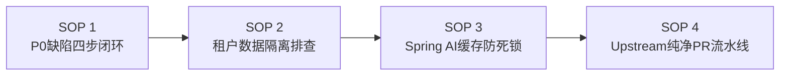
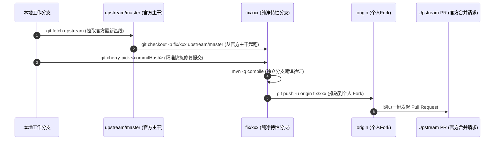

# XXL-AI 核心贡献与缺陷修复专家战法（Private Skill）

本 Skill 沉淀自 XXL-AI 核心系统架构实战，专用于处理高难度 P0 缺陷修复、多租户安全隔离、Spring AI 向量模型联动及向上游开源仓库的高质量 PR 提交流程。

---

## 一、架构红线与核心铁律（Ironclad Rules）

1. **单向依赖铁律（防止 Spring 循环依赖）**：
   - `business/{module}` 是功能完备的业务模块（包含全部 CRUD 和对外 Controller 入口）；
   - `harness` 是底层运行时支撑（模型构建、向量库、沙箱、对话流，**绝对不定义 Controller**）；
   - **单向流动**：业务 Service/Controller 注入 harness 工具；`harness` 可反向通过 Service/Mapper 读元数据配置；
   - **反向耦合红线**：基础业务（如 `SupplierService`）**绝对不可反向注入**上层工具（如 `RagTool`），否则会导致致命的 Spring 循环依赖（`supplierServiceImpl ⇄ ragTool`）。

2. **多租户/空间隔离铁律（SpaceContext Isolation）**：
   - 平台所有资源（供应商、模型、知识库、文档、Agent、统计数据、日志）必须遵循 `SpaceContext` 隔离；
   - 过滤逻辑必须下沉到 SQL（Mapper XML），禁止在内存中查全量后过滤；
   - 跨租户统计绝不能直接 `select count(1) from table`，必须强制携带 `where space_id = #{spaceId}`。

3. **Spring AI 向量缓存联动铁律（Reference Invalidation）**：
   - Spring AI 的 `MilvusVectorStore` 内部字段为 `private final EmbeddingModel embeddingModel`（强引用且不可变）；
   - 凭证更新（API Key / BaseUrl）后，即便 `LlmModelFactory` 重新生成了 `EmbeddingModel` 实例，若 `vectorStoreCache` 仅以 `baseId` 为键，向量库仍会永久复用旧的 401 失效实例；
   - **缓存键设计原则**：必须绑定内存对象指纹：`key = baseId + ":" + System.identityHashCode(embeddingModel)`，新实例天然未命中，未命中时在构建前自驱逐旧实例。

---

## 二、标准作业程序（SOP）



---

### SOP 1：P0 缺陷排查与四步闭环修复流

当遇到系统级 Bug 或架构缺陷时，严格遵循以下四步：

1. **步骤一：证据链确证（Evidence First）**
   - 拒绝猜测，先找代码或内存证据；
   - 查验 Spring Bean 依赖拓扑图，检查是否有闭环；
   - 查验对象引用哈希（`identityHashCode`），确认是否持有旧死实例。
2. **步骤二：方案预审与架构推演**
   - 拟定实施方案前，必须明确影响文件范围；
   - 方案中优先采用“自愈式/内存指纹”解耦，绝不采用引入反向依赖的饮鸩止渴式修复；
   - 提交方案供确认后再行动手改代码。
3. **步骤三：最小外科手术式编码**
   - 遵循“3 文件收敛法则”，只修改核心问题点，不制造多余的格式扩散或冗余注入；
   - 所有类与方法保留中文注释与 JavaDoc 规范。
4. **步骤四：双工作树编译对账**
   - 执行 `mvn -q compile` 验证 0 错误；
   - 若本地存在主分支（`master-local-study`）与工作树分支（`analyze_integrate_ai_projects`），必须两端同步落盘并验证。

---

### SOP 2：多租户/空间数据泄露排查清单

排查跨租户越权或统计泄露时，逐项对照下表：

| 检查项 | 脆弱点位置 | 标准修复模式 |
|---|---|---|
| **首页看板统计** | `DashboardServiceImpl.java` | 弃用无参全量 Mapper 统计，改调 `countBySpace(spaceId)` |
| **审计日志查询** | `SystemLogServiceImpl.java` | 从 `SpaceContext.getCurrentSpaceId()` 获取当前空间，非全局管理员强制拼接 `spaceId` 条件 |
| **供应商与模型** | `SupplierServiceImpl.loadRuntime` | 校验 `supplier.getSpaceId() == spaceId`，非法直接拒绝 |
| **知识库与文档** | `KnowledgeDocServiceImpl` | 校验文档所属知识库必须归属当前 `spaceId`，防止跨库篡改 |
| **Mapper XML** | `*Mapper.xml` 中的统计查询 | 统计与分页列表的 `<where>` 标签内必须显式包含 `<if test="spaceId > 0"> AND space_id = #{spaceId} </if>` |

---

### SOP 3：Spring AI 向量库与模型二级缓存死锁诊断指南

#### 1. 典型故障表现
用户在后台修改了供应商的 API Key（例如从错误 key 改为正确 key）并测试连通成功，但随后在发起知识库检索或对话时，仍然持续报错 `401 Unauthorized`，直到重启后端服务才能恢复。

#### 2. 根因剖析
```text
[用户更新 Key]
     ↓
SupplierService -> LlmModelFactory.evictSupplier(supplierId) 
     ↓ （此时 LlmModelFactory 缓存已清）
[发起检索]
     ↓
RagTool.resolveEmbeddingModel() -> 生成了持有新 Key 的全新实例 EmbeddingModel@0xBBBB
     ↓
RagTool.vectorStore() -> 以 baseId ("10") 查找 vectorStoreCache
     ↓ (致命点：命中旧缓存！)
返回持有着旧失效实例 EmbeddingModel@0xAAAA 的旧 MilvusVectorStore@0xM1
     ↓
调用 Milvus 接口 -> 报 401 失败！
```

#### 3. 终极自愈式修复模板（RagTool.java）
```java
// 1. 缓存键绑定内存哈希指纹
private MilvusVectorStore vectorStore(KnowledgeBase knowledgeBase, EmbeddingModel embeddingModel) {
    long baseId = knowledgeBase.getId();
    String key = baseId + ":" + System.identityHashCode(embeddingModel);
    
    MilvusVectorStore cached = vectorStoreCache.get(key);
    if (cached != null) {
        return cached;
    }
    
    // 2. 未命中（说明模型实例已更新），立即自驱逐该知识库历史残留的旧向量存储实例！
    evict(baseId);

    // 3. 传入新模型构建全新实例
    MilvusVectorStore store = MilvusVectorStore.builder(getMilvusClient(), embeddingModel)
            .databaseName(database)
            .collectionName(collectionName(baseId))
            .metricType(MetricType.COSINE)
            .indexType(IndexType.FLAT)
            .initializeSchema(true)
            .build();
    store.afterPropertiesSet();
    vectorStoreCache.put(key, store);
    return store;
}

// 4. 前缀匹配驱逐
public void evict(long baseId) {
    String prefix = baseId + ":";
    String exact = String.valueOf(baseId);
    synchronized (vectorStoreCache) {
        vectorStoreCache.keySet().removeIf(k -> k.equals(exact) || k.startsWith(prefix));
    }
}
```

#### 4. 模型精准驱逐（LlmModelFactory.java）
```java
public void evictModel(long supplierId, long modelId) {
    String prefix = supplierId + ":" + modelId + ":";
    String exact = supplierId + ":" + modelId;
    synchronized (chatModelCache) {
        chatModelCache.keySet().removeIf(key -> key.equals(exact) || key.startsWith(prefix));
    }
    synchronized (embeddingModelCache) {
        embeddingModelCache.keySet().removeIf(key -> key.equals(exact) || key.startsWith(prefix));
    }
}
```

---

### SOP 4：向上游官方（Upstream）贡献 PR 的纯净分支流水线

向开源上游提 PR 时，严禁直接使用含有本地合并历史（Merge commits）或实验代码的分支。必须执行以下工业级流水线：



#### 自动化命令行流水线（可直接复制执行）：
```bash
# 1. 保证工作区分支干净
git status

# 2. 拉取官方最新主干
git fetch upstream

# 3. 基于官方主干检出纯净特性分支
git checkout -b fix/my-feature-fix upstream/master

# 4. 精准挑拣提交（去除一切本地内部标签，保持提交语义凝练）
git cherry-pick <commit-hash>

# 5. 纯净分支编译验证
mvn -q compile -f xxl-ai-api/pom.xml

# 6. 推送至个人 Fork 仓库
git push -u origin fix/my-feature-fix

# 7. 切回日常开发分支
git checkout analyze_integrate_ai_projects
```

#### PR 描述黄金三段式模板：
```markdown
### 1. 问题背景 (Why)
- 清晰阐述缺陷触发场景与痛点（如 401 报错、跨租户越权等）；
- 指出官方当前版本存在的盲区或不可变对象持有的根因。

### 2. 修复方案 (How)
- 结构化列出各模块核心改动点（单向解耦、内存指纹绑定、精准驱逐）；
- 说明为何该解法不会破坏现有架构约束。

### 3. 验证情况 (Impact & Verify)
- 编译通过（0 error）；
- 说明实际场景验证结果（如配置热更新后即时生效，无需重启）。
```
