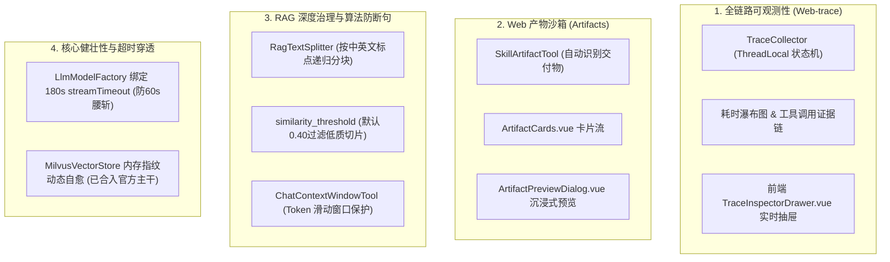

# XXL-AI 双端接力·工程现状与会话沉淀备忘录（Handover Briefing）

> **文档定位**：本文件由本地 Antigravity 会话自动提炼生成，专用于向 Antigravity 云端 Agent 传递工程上下文、已解决的技术深坑及架构决策。  
> **核心指令**：云端 Agent 启动新会话时，必须以此文档与根目录 `AGENTS.md` 作为事实基准，零沟通损耗接力本地研发。

---

## 一、工程基线与分支拓扑

1. **当前分支**：`dev-cloud`（基于官方 `upstream/master` 1.5.0-SNAPSHOT 模块化主干镜像构建）。
2. **远程关联**：
   * `origin`：`https://github.com/Qinstudy/xxl-ai.git`（个人开发 Fork 仓库，云端运行载体）。
   * `upstream`：`https://github.com/xuxueli/xxl-ai.git`（许雪里官方开源主干）。
3. **架构纪律（必须严格执行）**：
   * **方案先行铁律**：遇到任何新特性或缺陷改造，必须**先出实现方案与类影响清单**，待用户确认后再出码。
   * **PR 纯净分支铁律**：向上游官方贡献 PR 时，必须调用 `/xxl-ai-contributor` 检出独立纯净分支（如 `fix/xxx`），**严禁直接用 `dev-cloud` 发起 PR**。

---

## 二、本地已落地的核心能力资产（无需重复开发）

本地在 `master-local-study` 中已完成以下企业级深度能力的端到端研发，均已同步至 `dev-cloud`：

### 1. 全链路可观测性（Web-trace）
* **后端**：`TraceCollector.java` 采集 Agent 思考、工具调用耗时、LLM 首字延迟（TTFT）、Total Tokens 及证据链；
* **前端**：`TraceInspectorDrawer.vue` 提供可视化耗时瀑布图与实时追踪日志；
* **数据库**：`doc/db/update_v1.4_observability.sql`（包含 `xxl_ai_trace_record` 建表）。

### 2. Web 端产物沙箱（Artifacts）
* **后端**：`SkillArtifactTool.java`，自动捕获模型生成的代码、HTML、Markdown 与 SVG，持久化存储并暴露预览/下载端点；
* **前端**：`ArtifactCards.vue` 与 `ArtifactPreviewDialog.vue`，实现类似 Claude Artifacts 的即时交互。

### 3. RAG 深度切分与召回治理
* **递归分块器**：`RagTextSplitter.java`，彻底解决按生硬字符截断导致的中英文断句、代码块破损问题；
* **阈值过滤**：`KnowledgeBase` 引入 `similarity_threshold`（默认 0.40），底层向量检索低于阈值自动剔除；
* **数据库**：`doc/db/patch_20261025_p0_rag_threshold.sql`。

### 4. 传输超时穿透
* `LlmModelFactory.java` 读取 `@Value("${xxl-ai.chat.stream.timeout:180000}")`，向 `OpenAiChatOptions` 显式注入 `.timeout(Duration.ofMillis(streamTimeout))`，彻底解决 OkHttpClient 默认 60s 超时中断长文本生成的致命痛点。

---

## 三、核心参考文档导航

云端 Agent 在进行方案设计时，以仓库内保留的 **2 份核心文档** 作为最高权威参考：
1. **`docs/XXL-AI-核心缺陷与功能演进优先级总表-v1.0.md`**：
   * 包含缺陷总表（P0~P3）与功能演进蓝图，标注了当前各任务的状态与优先级。
2. **`docs/三项目对标总表-v2.0.md`**：
   * 对标 `LightBot` 与 `aiagentdemo` 的架构全景、算法选型（模型路由、记忆压缩、提示词工程），是后续架构优化的设计库。

---

## 四、历史踩坑血泪经验（避坑指南）

1. **单向依赖红线（防 Spring 循环依赖死锁）**：
   * 业务模块（`business`）可调用底层支撑（`harness`）；
   * `harness` 底层组件绝不能反向注入上层业务 Service（如 `RagTool` 绝不能反向注入 `SupplierService`），否则 Spring 容器启动必定崩溃。
2. **多租户/空间隔离铁律**：
   * 任何业务查询必须强制携带 `SpaceContext.getCurrentSpaceId()`，禁止在 Java 内存中做全量查出后的伪过滤。
3. **Spring AI OpenAI 扩展挂载**：
   * 自定义请求头必须挂到每个 `model.headers`，而不是 `provider.headers`（Spring AI 底层只有 model 级 header 会被合并）。
4. **外部参考库隔离**：
   * `refs/` 与 `xxl-ai-spec/` 属本地历史文件，禁止 `git add` 推送，保持仓库纯净。

---

## 五、云端接力建议指令

在 Antigravity 云端开启会话后，直接发送以下指令即可启动接力：
> *“已阅读 `docs/CLOUD_HANDOVER_CONTEXT.md`。我已知晓已落地的 Web-trace、Artifacts、RAG 递归分块及超时对齐等功能，以及两份核心对标文档。请告诉我下一步我们推进哪项任务，我将严格遵循先方案后编码的规范执行。”*
