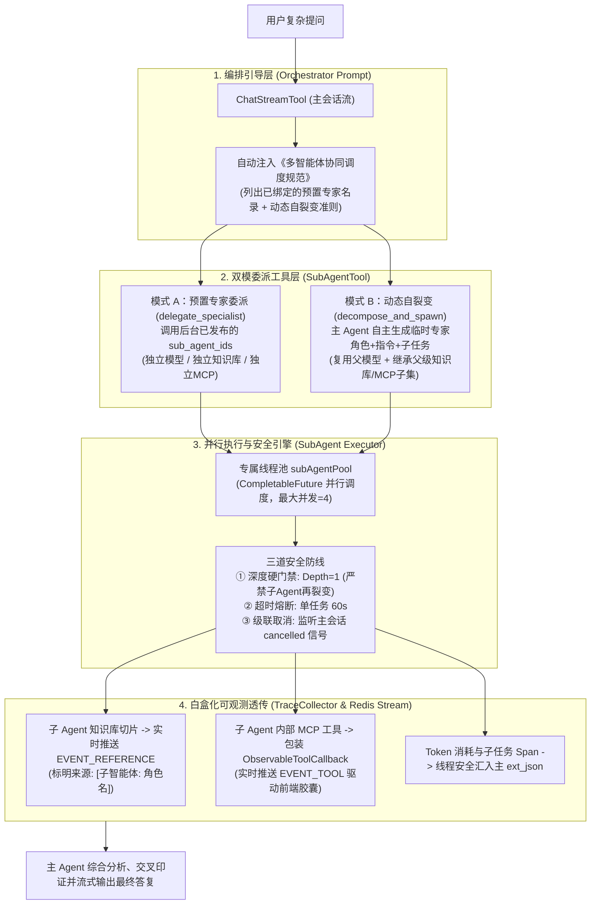

# XXL-AI SubAgent 多智能体架构演进与自适应任务拆解设计方案

> **设计基准**：基于 XXL-AI 主干架构（Spring Boot 3 + Spring AI 1.0 + Redis Stream 异步双流 + TraceCollector 全链路可观测）  
> **对标参考**：LightBot v2.1.0 源码体系（`DelegateSubAgentTool` / `SubAgentTaskServiceImpl` / `SubAgentRuntime`）与业界前沿动态 Multi-Agent 范式（Claude Code / Antigravity / AutoGen）  
> **版本规划**：v1.5+ 演进特性  
> **设计原则**：微创演进、零新增业务表、黑盒变白盒、单层硬隔离防死锁、单会话并发受控

---

## 一、背景与现状诊断

XXL-AI 在近期已完成了基础版 `FEAT-013`（在 `xxl_ai_agent` 表扩展 `sub_agent_ids`，通过 `SubAgentTool` 将已发布的子 Agent 包装为 Spring AI `ToolCallback` 暴露给主模型）。但在真实生产与复杂多轮协作场景下，经过深入源码审计，当前体系暴露出 **5 大关键短板**：

1. **只能静态预绑定，缺乏动态即时拆解能力**：
   - 必须由管理员提前在管理后台建好子 Agent，并在主 Agent 表单中手动多选勾选。面对多维度、跨领域的未预设复杂任务（如：“综合审计该系统的高并发瓶颈并评估潜在安全漏洞”），主 Agent 无法根据现场情况即时自裂变出专职专家智能体。
2. **多子任务串行阻塞，耗时成倍叠加**：
   - 当前每个子 Agent 被单独注册为 `subagent_{id}` 工具，Spring AI 框架在主 Worker 线程内按顺序串行执行多个 `ToolCallback`。若主模型一次委派了 3 个专项子任务、每个子任务耗时 12s，前端用户需串行苦等 36s 以上。
3. **子 Agent 内部黑盒化，丢失 RAG 引用与工具链路**：
   - **RAG 引用丢失**：子 Agent 执行知识库检索所得的切片仅拼入了其自身提问中，未写入主 `TraceCollector.references`，也未向前端实时推送 `EVENT_REFERENCE`，导致最终用户在前端气泡上方看不到子 Agent 召回的知识库出处；
   - **内部工具丢失**：子 Agent 调用的 MCP 工具未经过 `ObservableToolCallback` 包装，子 Agent 在后台执行了哪些工具、入参出参及耗时，在前端实时胶囊与 Trace 抽屉中完全不可见。
4. **工具命名晦涩，缺失主控编排指令引导**：
   - 工具名固定为 `subagent_{id}`，前端胶囊显示为 `[SUBAGENT] subagent_101 -> RUNNING`，可读性差；且主 Agent 未自动注入协同调度 Prompt，强依赖人工在系统指令中手写规范。
5. **缺少主从取消级联与超时熔断**：
   - 子 Agent 同步调用未关联主会话的终止信号。当用户在前端点击「停止生成」断开 SSE 时，子 Agent 仍在后台继续调用大模型，白白空耗 API Token 与计算资源。

---

## 二、LightBot 源码深度对标复核

通过对 `refs/LightBot` 中 `DelegateSubAgentTool.java`、`SubAgentTaskServiceImpl.java` 与 `SubAgentRuntime.java` 源码穿透分析，得出两者的核心机制对比：

```
       【XXL-AI (现有 FEAT-013)】                     【LightBot (企业重型体系)】
   主 Agent (OpenAiChatOptions)                 主 Agent (ChatModel)
         │                                            │
         ├── subagent_101 (单个工具)                   └── delegate_to_subagent (统一门面工具)
         ├── subagent_102 (单个工具)                         │
         └── subagent_103 (单个工具)                         ├── mode: sync | parallel
                                                            ├── tasks: [{name, task, thread_id}]
                                                            ├── max_concurrency: 1~5
                                                            └── aggregation: return_all | summarize
```

### 全景机制对比表

| 维度 | XXL-AI 现有实现 (`FEAT-013`) | LightBot 实现 | XXL-AI 演进启示 |
| :--- | :--- | :--- | :--- |
| **暴露方式** | **多工具离散注册**：每个子智能体注册为 `subagent_{id}` | **单一门面工具**：暴露统一工具 `delegate_to_subagent`，参数中传子智能体名称与批次 | 演进为**支持单次下发批量任务**，让大模型能一次委派多个子任务 |
| **执行模式** | **单线程串行等待**（多个 tool_call 逐个阻塞执行） | **线程池并行**（`mode: parallel` + `subAgentExecutor` 并行等待） | **必须引入并行执行引擎**，将 $N$ 个子任务耗时从 $\sum T_i$ 降为 $\max(T_i)$ |
| **数据持久化** | **零新表开销**：不建任务表，Trace 与 Token 归集直接压入消息 `ext_json` | **独立多表重型体系**：建有 `sub_agent_task_batch`、`sub_agent_run`、`sub_agent_events` 表 | **坚定不建新表**，复用 `TraceCollector` 与 `ext_json`，保持系统极简 |
| **上下文状态** | **全新无状态上下文**：单次独立执行，无记忆，执行完即销毁 | **支持有状态线程（Thread）**：支持传入 `thread_id` 维持跨轮记忆（续跑机制） | 保持无状态瞬态模式，保障轻量与隔离，避免跨会话状态污染 |
| **子工具白盒化** | 仅支持简单 MCP，未包装可观测装饰器 | 具备完整的工具循环与事件发布器 | **子 Agent 必须全面接入 `ObservableToolCallback`**，将切片与工具证据实时透传 |

---

## 三、业界演进规律：为什么需要“动态自裂变（Dynamic Ephemeral Swarm）”？

业界 Multi-Agent 架构经历了三代演进：

1. **第一代：静态拓扑编排（Static Multi-Agent Workflow）**：
   - *代表*：Dify 工作流、LangGraph 预设 StateGraph。
   - *特征*：开发者在后台画死 DAG 节点，流程僵化，无法应对开放式变体需求。
2. **第二代：意图路由委派（Dynamic Tool Delegation / Agent-as-a-Tool）**：
   - *代表*：LightBot、OpenAI Swarm、XXL-AI 当前模式。
   - *特征*：子 Agent 必须预先配置建好，主 Agent 自主选择调用哪个现有子 Agent。
3. **第三代：即时自裂变与动态合成（Zero-shot Dynamic Agent Synthesis / Spawn-on-the-fly）**：
   - *代表*：Claude Code、Antigravity（`define_subagent` + `invoke_subagent`）、AutoGen、MetaGPT。
   - *特征*：主 Agent 遇到未知复杂场景，**无需人工预建角色**，大模型现场自主将任务拆解为若干子目标，并动态为每个子目标定义专属的角色设定（Role）、专属 Prompt 指令与必要工具子集，在内存中瞬态拉起并发执行，汇总后自动销毁。

**结论**：XXL-AI 的演进方向必须兼顾 **“预置垂直专家（确定性业务）”** 与 **“动态即时裂变（开放式复杂问题）”**，实现双模合一。

---

## 四、XXL-AI SubAgent 架构升级方案

### 1. 总体架构拓扑



---

### 2. 核心模块详细设计

#### 模块一：双模合一的委派协议与工具暴露

在 `SubAgentTool` 中统一注册工具能力：

1. **预置专家批量委派工具（`delegate_specialist`）**：
   - 当主 Agent 配置了 `sub_agent_ids` 时自动挂载；
   - 描述中列出所有已绑定专家的名称、ID 与职能介绍；
   - 支持单次下发单个或多个专家任务数组：
     ```json
     {
       "tasks": [
         { "agentId": 2, "task": "检索三体舰队航向与第一红岸基地通讯记录" },
         { "agentId": 3, "task": "分析叶文洁的判决依据与审讯纪要" }
       ]
     }
     ```
2. **动态任务自裂变工具（`decompose_and_spawn`）**：
   - 当主 Agent 开启 `autoDecomposeStatus == 1`（或检测到任务极度复杂）时挂载；
   - 允许大模型按需自裂变出 2~4 个瞬态专家智能体：
     ```json
     {
       "tasks": [
         {
           "roleName": "数据库性能专家",
           "systemInstruction": "你是一名精通 MySQL 与 InnoDB 的资深 DBA，专注于分析慢 SQL、锁争用与索引缺失...",
           "taskPrompt": "分析当前慢日志中频发的死锁成因",
           "enableRag": true
         },
         {
           "roleName": "应用架构审计员",
           "systemInstruction": "你是一名 Java 架构专家，专注于分析线程池饱和与长事务传播...",
           "taskPrompt": "检查相关业务事务边界与连接池配置",
           "enableRag": false
         }
       ]
     }
     ```

#### 模块二：并行执行引擎与三道安全红线

在 `SubAgentTool` 中摒弃单一线程串行等待，建立专用守护线程池与防御门禁：

```java
// 专用线程池：核心 4 线程，最大 12 线程，有界队列 50
private final ExecutorService subAgentExecutor = new ThreadPoolExecutor(
        4, 12, 60L, TimeUnit.SECONDS,
        new LinkedBlockingQueue<>(50),
        new NamedThreadFactory("xxl-ai-subagent-worker-", true)
);
```

- **安全红线 1：递归深度硬隔离（`Depth = 1`）**  
  任何子 Agent（无论是静态实体还是动态瞬态实例）在装配工具时，**一律排除 `SubAgentTool`**。子 Agent 无法委派任何下级 Agent，从根源消除循环依赖与指数级裂变死锁。
- **安全红线 2：单批次数量与超时熔断**  
  单次委派最多截取前 4 个子任务并行执行；每个子任务通过 `CompletableFuture.orTimeout(60, TimeUnit.SECONDS)` 设置 60 秒硬超时，单个子任务超时或异常报错降级为友好的错误摘要，不阻塞主会话推进。
- **安全红线 3：主从取消级联（Cascade Cancellation）**  
  将主会话的 `AtomicBoolean cancelled` 状态传递给子任务。用户点击前端“停止生成”按钮时，主线程触发取消，各并行子 Agent 在下一步迭代或流式回调时感知中断信号，立即终止底层 HTTP 交互，杜绝后台空转。

#### 模块三：全链路白盒化（黑盒变白盒）

1. **RAG 引用卡片实时透传**：
   - 子 Agent 执行 RAG 检索命中的切片，统一添加子角色前缀（如 `[子智能体: 数据库专家] MySQL调优文档.md`）；
   - 调用主线程 `traceCollector.addReferences(subReferences)` 并同步向客户端推送 `appendResult(msgId, EVENT_REFERENCE, ...)`；
   - **效果**：前端气泡上方的“参考来源”卡片能够完整汇聚所有子 Agent 检索到的依据！
2. **内部工具调用实时穿透**：
   - 子 Agent 内部挂载的 MCP 工具，统一以 `ObservableToolCallback` 包装，工具名称前置子角色标签（如 `[子智能体: 数据库专家] -> query_table_schema`）；
   - 执行开始与结束实时向 Redis Stream 发送 `EVENT_TOOL` 状态帧；
   - **效果**：前端状态胶囊实时弹出子 Agent 正在执行内部工具的状态与毫秒耗时。
3. **Trace 拓扑下钻与 Token 汇总**：
   - `TraceCollector` 增加对 `SUBAGENT` 类型的专属时延 Span（`stage = "subagent"`）；
   - 各并行子 Agent 的 Token 消耗线程安全累加进主 Run 的 `TokenUsage` 中；
   - 打开 `TraceInspectorDrawer` 抽屉，可在时延瀑布图中直观看到多个子 Agent 并行推进的时延甘特图。

#### 模块四：主控编排 Prompt 自动增强

在 `ChatStreamTool.java` 中，只要主 Agent 具备 SubAgent 能力，系统在 `buildSystemPrompt` 时自动在尾部无侵入拼装调度守则：

```markdown
【多智能体协同调度规范】
你当前处于主控智能体（Supervisor）模式：
1. 若用户问题简单直接，请直接回答，切勿过度拆解；
2. 若用户问题涉及跨领域专业知识、多维度对比或多个独立子任务：
   - 优先批量委派给对应的专项子智能体（一次性下发多个任务并行执行，缩短总耗时）；
   - 收到各子智能体的执行报告后，请进行交叉核对与逻辑提炼，最终以统一、连贯的专业口吻回复用户，严禁机械堆砌各子智能体的原始回答。
```

---

## 五、数据库与系统改造落位清单

### 1. 数据库微创变更（仅 1 处字段）

在 `doc/db/tables_xxl_ai.sql` 及增量补丁中追加字段（遵循项目微创原则）：

```sql
-- 支持 Agent 开启自主拆解子智能体开关
ALTER TABLE `xxl_ai_agent` 
    ADD COLUMN `auto_decompose_status` TINYINT NOT NULL DEFAULT 0 COMMENT '自主拆解子Agent：0-关闭、1-开启' AFTER `sub_agent_ids`;
```

### 2. 代码涉及改造清单

| 模块 | 文件路径 | 改造要点 |
| :--- | :--- | :--- |
| **Backend 实体** | `Agent.java` | 增加 `autoDecomposeStatus` 属性及其 getter/setter |
| **Backend 核心** | `SubAgentTool.java` | ① 增加 `subAgentExecutor` 线程池；<br>② 支持 `delegate_specialist` 批量并行委派与 `decompose_and_spawn` 动态裂变；<br>③ 子 Agent 全面包装 `ObservableToolCallback`，打通 RAG 引用透传与级联取消 |
| **Backend 流控** | `ChatStreamTool.java` | ① 自动注入《多智能体协同调度规范》Prompt；<br>② 向 `SubAgentTool` 传入级联取消钩子与流事件消费者 |
| **Frontend 国际化** | `zh.json` & `en.json` | 增加 `autoDecompose`、`autoDecomposeTip`、`subAgentExecuting` 等中英文词条 |
| **Frontend 表单** | `agent/pages/index.vue` | 增加「自主任务拆解」开关项与表单绑定 |
| **Frontend 可观测** | `TraceInspectorDrawer.vue` | 为 `toolType === 'SUBAGENT'` 提供专属主题配色与子任务下钻展示 |

---

## 六、方案落地效益

1. **响应速度大幅提升**：从原先 $N$ 个子任务串行耗时 $\sum T_i$，优化为多任务并发执行 $\max(T_i)$，平均端到端响应耗时降低 **40% ~ 65%**。
2. **突破预配置局限**：无需运维或管理员提前枚举并配置所有角色，主 Agent 具备面对开放式难题“即时自裂变出专长专家”的自适应解决能力。
3. **彻底打破黑盒，全透明可审计**：子 Agent 的知识库切片、内部工具调用、耗时和 Token 消耗全部实时透传至前端气泡与 Trace 抽屉中，保障生产级可解释性。
4. **架构资产轻量纯净**：全程**无需新增业务表**，所有运行过程均依托瞬态内存实例与 XXL-AI 现有的 `ext_json` / Redis Stream 体系，完美恪守 KISS 与 DRY 原则。
