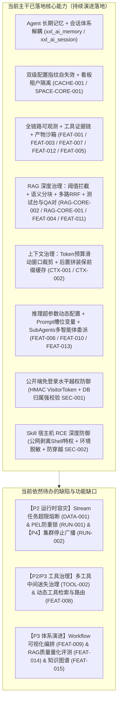
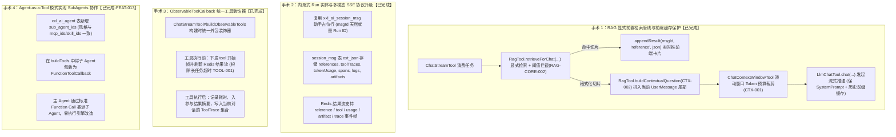

# XXL-AI 核心缺陷与功能演进优先级总表 v1.4

> **状态**：持续演进定稿（已融合用户 8 处评审意见、源码深度审计纠偏、Harness 4 项微创手术，并于 2026-11-08 完成源码现状对账与 `[FEAT-005]` 落地验收）  
> **评估基准**：基于 XXL-AI 当前主干源码、5 卷沉淀文档及对标参考项目（LightBot / AiAgentDemo）实测比对  
> **归档位置**：`docs/XXL-AI-核心缺陷与功能演进优先级总表-v1.0.md`  

---

## 零、 评估背景与评审变更说明

本文档基于 `docs/` 体系中核心文档深度提炼，融合用户第一轮评审提出的 **8 处明确意见**，并进一步对标 Java 开发者完整的 AI Agent 构建与管理方案（涵盖 **Agent 引擎、Workflow 可视化编排、RAG 知识库、AI 扩展体系、评测体系、全链路可观测** 6 大核心支柱）进行了全景核对与补齐。

### 0.1 用户 8 处评审意见变更追踪
1. **`[SEC-001]` 公开端免登录越权 (IDOR)**：从 P0 调整至 **P2 级别**（在当前本地与私有化研发验证场景中，公网越权不作为首要阻断项）。
2. **`[SEC-002]` Skill 宿主机裸奔导致公网 RCE**：从 P0 调整至 **P2 级别**（目前开发环境默认由受信管理员操作，暂不阻塞核心链路）。
3. **`[DATA-001]` 任务流堆积静默裁剪丢弃**：从 P0 调整至 **P2 级别**（归入并发与容灾长效加固范畴）。
4. **`[RUN-001]` PEL 故障接管无幂等重复计费**：从 P0 调整至 **P2 级别**（归入运行时运维与重试防重加固范畴）。
5. **`[RAG-CORE-002]` 检索无相似度阈值（垃圾注入）**：从 P1 提升至 **P0 致命级别**（严重破坏模型回答准确性，用户闲聊强行注入无关分块导致模型严重幻觉，直接影响现阶段测试效果，必须立即止血）。
6. **`[LLM-001]` 模型底层调用受限于 OkHttp 60s 隐式超时**：从 P1 调整至 **P2 级别**（【已完成-261107】）。
7. **`[TOOL-001]` 超长 ToolCall 输出导致 SSE 转发通道超时**：从 P1 调整至 **P2 级别**（【已完成-261103】）。
8. **供应商/模型配置热更新机制归属纠偏**：**彻底移出“功能项”清单**！配置修改后后台持久化成功但内存缓存不淘汰属于典型的**缓存与持久化状态不一致缺陷**，正式定性为 **`[CACHE-001] 供应商与模型缓存未驱逐（热修失效）`**（**【源码核对：已修复】**——当前主干已落实 `configSignature` 配置指纹与 `evictSupplier/evictModel` + `RagTool#vectorStore` 模型身份哈希失效）。

### 0.2 基于源码深度审计的现状纠偏（2026-11-08 核对）
1. **`[FEAT-002]` 大模型生成主动终止 (Stop)**：在单机维度**已经全链路实现**（前端 Stop 按钮 + 后端 `/chat/stop` + 线程中断 + Skill 进程回收闭环），故不再作为从零开发的 P1 功能；仅在 P2 容灾缺陷中登记 `[RUN-002] 多实例集群部署下 /stop 跨节点终止失效`。
2. **`[FEAT-011]` 知识库检索测试台 (Playground)**：`doc.vue` 与 `/knowledge/doc/search` 中已内置向量检索测试弹窗，演进重心纠偏为“在弹窗中补充文档名 `docName` 回显、临时参数调节及新增 QA 问答对”。
3. **`[CACHE-001]` 连环缓存死锁与 `[SPACE-CORE-001]` 看板跨租户泄露（均已修复）**：
   - `LlmModelFactory` 已在缓存条目保存 `configSignature(baseUrl, runtime)` 并由 `SupplierServiceImpl` / `SupplierModelServiceImpl` 在增删改时显式调用 `evictSupplier` / `evictModel`，`RagTool#vectorStore` 已将 Key 升级为 `baseId + ":" + System.identityHashCode(embeddingModel)` 并在未命中或知识库变更时调用 `evict(baseId)`；
   - `DashboardController` 的 `/stats`、`/sessionMsgTrend`、`/sessionMsgShare` 已强制经 `spaceService.checkSpace` 校验后调用 `countBySpaceId` / `SessionMsgMapper#trendListBySpace` / `agentShareBySpace` 按 `space_id` 隔离。

---

## 一、 演进现状核查总览（已做 vs 未做）



---

## 二、 【已修复复盘】为什么“供应商与模型缓存未驱逐”曾是 P0 双级死锁？

> **核对状态：已在主干修复（保留本文用于技术复盘）** —— 目前 [`LlmModelFactory.java`](file:///E:/code/spring-ai-project/juejin-gitee/xxl-ai-workbuddy/xxl-ai-api/src/main/java/com/xxl/ai/api/business/harness/llm/LlmModelFactory.java)、[`SupplierServiceImpl.java`](file:///E:/code/spring-ai-project/juejin-gitee/xxl-ai-workbuddy/xxl-ai-api/src/main/java/com/xxl/ai/api/business/supplier/service/impl/SupplierServiceImpl.java)、[`SupplierModelServiceImpl.java`](file:///E:/code/spring-ai-project/juejin-gitee/xxl-ai-workbuddy/xxl-ai-api/src/main/java/com/xxl/ai/api/business/supplier/service/impl/SupplierModelServiceImpl.java) 与 [`RagTool.java`](file:///E:/code/spring-ai-project/juejin-gitee/xxl-ai-workbuddy/xxl-ai-api/src/main/java/com/xxl/ai/api/business/harness/rag/RagTool.java) 已完整落地“配置指纹自失效（主）+ 写后显式驱逐（辅）”。

### 2.1 缺陷本质定性：从“需求”到“Bug”
在常规 Web 系统的认知中，“热更新”有时被视作高级功能，但在 XXL-AI 的业务场景下，这属于**破坏数据一致性的严重 Bug**：
1. **符合用户心智的黄金定律**：在管理后台点击“保存”按钮并提示“修改成功”后，后续一切业务调用必须基于最新生效的数据。
2. **早期双级连环死锁原理**：
   - **第一级模型死锁（`LlmModelFactory.java`）**：早期缓存 Key 仅为 `supplierId + ":" + modelId`，未比对配置指纹，更新 API Key / URL 后旧实例长期滞留 LRU 缓存。
   - **第二级向量库死锁（`RagTool.java`）**：`vectorStoreCache` 曾以纯 `baseId` 为 Key 缓存 `MilvusVectorStore`（强引用构造时的旧 `EmbeddingModel`），即便第一级模型重建也会被第二级缓存截留并继续抛出 `401 Unauthorized`。

### 2.2 自愈方案落地情况：配置指纹自失效（主）+ 显式驱逐（辅）
1. **`LlmModelFactory` 配置指纹比对**：在 `ChatModelEntry` / `EmbeddingModelEntry` 中记录 `configSignature(baseUrl, runtime)`（散列 `baseUrl`、`apiKey`、`modelName`、`headers`），命中缓存时比对签名，不一致即自动重建，支持集群所有节点感知。
2. **`RagTool` 模型引用指纹**：`vectorStoreCache` 的 Key 拼入 `baseId + ":" + System.identityHashCode(embeddingModel)` 并在未命中时调用 `evict(baseId)` 清理旧实例。
3. **写侧显式驱逐兜底**：`SupplierServiceImpl`（`evictSupplier`）、`SupplierModelServiceImpl`（`evictModel`/`evictSupplier`）与 `KnowledgeBaseServiceImpl`（`ragTool.evict`）在更新/删除后立即清理本地缓存。

---

## 三、 【缺陷事项全景清单】与优先级划分 (Defects)

### 3.1 评级准则
- **P0（致命/核心止血与精度命脉）**：破坏系统核心可用性、导致后台配置热改失效、RAG 检索无阈值灌入垃圾切片导致模型严重幻觉、跨租户敏感数据穿透。
- **P1（高优/核心算法质量与上下文治理）**：RAG 字符分块暴力腰斩代码/单词、固定条数截断打爆上下文 Token 限制、动态 RAG 切片拼入头部 `SystemMessage` 击穿多轮前缀缓存（Prefix KV Cache）。
- **P2（中优/公网防御、并发容灾与长任务稳定性）**：公开端免登录水平越权遍历 (IDOR)、Skill 宿主机裸奔公网 RCE、任务流超限丢弃、PEL 接管无幂等、OkHttp 60s 隐式超时、流式中断 Token 统计漏记、超长 ToolCall 超时、RAG 静默黑盒、61 工具中间迷失、自动化测试不足。
- **P3（低优/规范与协议边缘判定）**：MCP `/sse` 字符串误判等边缘代码异味。
- **P4（远期/极端多实例集群低频运维）**：多实例集群部署下 `/stop` 跨节点终止失效（单机已闭环，集群广播依赖分布式 Pub/Sub，归入远期增强）。

---

### 3.2 缺陷分类总表 (Defect Matrix)

| 级别 | 缺陷编号 | 缺陷分类 | 缺陷名称与源码证据位置 | 影响与危害表现 | 修复状态 / 改造建议 |
|---|---|---|---|---|---|
| **P0** | **[CACHE-001]** | 元数据一致性 | **供应商与模型缓存未驱逐（双级连环死锁）**<br>`LlmModelFactory.java#L79-85,L145-174`<br>`RagTool.java#L143-149,L474-482` | 早期改 Key/URL 后对话与向量化继续复用旧实例报错 401，非重启不可恢复。 | **【已完成】** 已采用双级指纹自失效（配置哈希 + `identityHashCode`）+ `evictSupplier/evictModel/evict` 显式驱逐闭环。 |
| **P0** | **[RAG-CORE-002]** | 算法精度 | **检索无相似度阈值（硬取 Top-K 垃圾注入）**<br>`RagTool.java#L209-212`<br>`KnowledgeBase.java` | `SearchRequest` 未配置 `similarityThreshold`。用户问无关闲聊也会强行将低相关切片喂给大模型，**诱发严重幻觉**。 | **【已完成】** 知识库配置增加 `similarity_threshold`（默认 0.40），底座向量检索与多路融合后置均已实现阈值过滤拦截。 |
| **P0** | **[SPACE-CORE-001]** | 租户安全 | **首页看板统计跨租户全量泄露**<br>`DashboardController.java#L48-98`<br>`SessionMsgMapper.xml#L143-164` | 早期图表与统计 SQL 缺少 `space_id` 过滤，可透视全平台消息量与他租户 Agent 名称。 | **【已完成】** `/stats`、`/sessionMsgTrend`、`/sessionMsgShare` 均已校验 `spaceService.checkSpace` 并隔离至 `countBySpaceId`、`trendListBySpace`、`agentShareBySpace`。 |
| **P1** | **[RAG-CORE-001]** | 算法精度 | **字符暴力截断导致的破词与断句**<br>`RagTool.java#L530-548` | `split()` 纯按字符长度 `substring` 截断，长单词与代码行被腰斩，破坏语义原子性导致召回率骤降。 | **【已完成】** 引入 `RagTextSplitter` 递归语义分块器（段落 -> 句子 -> 空格逐级切分），并保护 QA 问答对原子切分。 |
| **P1** | **[CTX-001]** | 上下文治理 | **历史上下文按固定条数截断易爆 Token**<br>`ChatStreamTool.java#L151,L795` | 历史消息固定取最近 `historyLimit` 条（默认 50 条）。遇到长代码或长文档总结易打穿模型 Context Window 触发 HTTP 400。 | **【已完成】** 引入 `ChatContextWindowTool`（基于 JTokkit `cl100k_base` 编码），按 Token 预算倒序滑动窗口裁剪，确保 user 起始轮次完整。 |
| **P1** | **[CTX-002]** | 上下文治理 | **动态 RAG 切片拼入 `SystemMessage` 击穿多轮前缀缓存**<br>`RagTool.java#L358-381`<br>`ChatStreamTool.java#L838` | `RagTool#injectContextPrompt` 仍将每轮动态检索到的切片直接拼入头部 `SystemMessage`，导致多轮追问时历史消息的 Prefix KV Cache 全量失效，推高 TTFT 与输入成本。 | **【已完成】** 遵循“静态前置、动态后置”原则：采用 `RagTool#buildContextualQuestion` 将动态检索上下文拼在队尾**当前 `UserMessage`** 上（保住前缀缓存，且不污染数据库用户原话）。 |
| **P2** | **[SEC-001]** | 安全越权 | **公开端免登录接口越权遍历 (IDOR)**<br>`ChatController.java`<br>`ChatSessionController.java`<br>`VisitorSecurityTool.java` | 接口免登录，仅凭客户端入参遍历或伪造 `visitorId`/`sessionId`，存在越权读取或删除其他访客会话风险。 | **【已完成】** 签发基于 HMAC-SHA256 签名的 `X-Visitor-Token`，前后端双向刷新流转；Session/Chat 接口对会话归属做 DB 强校验与阻断。 |
| **P2** | **[SEC-002]** | 安全隔离 | **Skill 执行器宿主机公网 RCE**<br>`SkillToolFactory.java`<br>`SkillShellTracker.java`<br>`ChatStreamTool.java` | 仅限定 `workingDirectory`/`allowedDirectory`，公网免登录端通过 Prompt 注入直接调用 `ShellTools` 执行系统级 Bash 命令。 | **【已完成】** 公网发布态自动剥离 `ShellTools` 执行特权（保留安全文件工具与知识库）；环境变量全面脱敏（剔除密码/秘钥）；物化阶段增加规范路径强防穿越校验；命令执行施加 120s 强制超时熔断。 |
| **P2** | **[DATA-001]** | 运行时容灾 | **任务流堆积超限导致静默丢弃任务**<br>`ChatStreamTool.java#L105,L366` | 积压超过 5000 条时 Redis `approximateTrimming` 会静默丢弃旧任务，用户端可能无异常反馈。 | 入队前执行 `XLEN` 预检，超限时主动熔断并返回友好错误。 |
| **P2** | **[RUN-001]** | 资产损耗 | **PEL 故障接管无幂等导致重复计费**<br>`ChatStreamTool.java#L400-451` | Worker 故障认领未确认任务后直接重新执行，若前节点已部分调用模型，可能引发二次计费。 | 基于 `SETNX xxl:ai:run:lock:{msgId}` 建立分布式防重执行锁。 |
| **P4** | **[RUN-002]** | 运行时容灾 | **多实例集群部署下 `/stop` 跨节点终止失效**<br>`ChatStreamTool.java#L158,L333` | `runContexts` 保存在单机 JVM 内存中，集群节点 `/stop` 路由到非执行节点时无法中断流。 | 引入 Redis Pub/Sub 广播终止事件，或基于 Redis 取消标记位驱动 Worker 退出。（已降级至 P4 远期支持） |
| **P2** | **[LLM-001]** | 运行时故障 | **模型底层调用受限于 OkHttp 60s 隐式超时**<br>`LlmModelFactory.java#L48-50,L94` | 推理模型长思考或长文输出超过 60s 被默认 Socket 超时强制掐断。 | **【已完成-261107】** 工厂构建 `OpenAiChatOptions` 时显式设置 `.timeout(Duration.ofMillis(streamTimeout))` 对齐 180s。 |
| **P2** | **[LLM-002]** | 可观测盲区 | **流式中断/异常终止时 Token 账单漏记（归零缺失）**<br>`LlmChatTool.java#L184-203`<br>`ChatStreamTool.java#L540-570` | 流式协议仅在尾帧下发 `usage`。当流中途异常断流（`FAILED`）或主动停止（`CANCELLED`）时未收到尾帧，导致 `tokenUsage` 落库为 `0`。 | **【已完成-261110】** 尾帧精确值优先 + 中断/异常或未收到尾帧时采用 JTokkit 本地分词器按已输入与已生成文本估算兜底并打标 `estimated: true`。 |
| **P2** | **[TOOL-001]** | 运行时故障 | **超长 ToolCall 输出导致 SSE 转发通道超时**<br>`ObservableToolCallback.java`<br>`ChatStreamTool.java#L824,L914` | 超大工具调用期间无事件写入，易使流式通道静默超时断开。 | **【已完成-261103】** 通过 `ObservableToolCallback` 装饰器实时下发 `RUNNING/SUCCESS/ERROR` `tool` 帧保活结果流并截断保护（模型侧 16000 字符、Trace 侧 1000 字符）。 |
| **P2** | **[RAG-003]** | 交互体验 | **RAG 静默黑盒模式（分块与来源元数据丢失）**<br>`RagTool.java#L282-353`<br>`ChatStreamTool.java#L834-840` | 早期依赖默认 Advisor 吞噬切片来源，前端无法感知命中哪篇文档及相似度得分。 | **【已完成-261103】** 已改造为 `RagTool#retrieveForChat` 显式前置检索管线，随 SSE 推送 `reference` 帧并在前端折叠展示来源卡片。 |
| **P2** | **[TOOL-002]** | 提示词工程 | **单 Agent 挂载多工具导致的“中间迷失”踩踏**<br>*(来源: 实战排雷卷)* | 绑定大量 MCP/Skill 工具后全量注入 Schema，消耗大量上下文且易引发工具选择退化。 | 引入动态工具路由（Tool Retrieval），按用户意图检索最相关工具注入上下文。 |
| **P2** | **[PROT-001]** | 协议判定 | **MCP 服务 `/sse` 判定采用粗暴字符串包含**<br>`McpClientTool.java#L197` | `config.url.contains("/sse")` 易将包含 `sse` 子串的非 SSE 地址误判为 SSE 传输模式。 | **【已完成-261110】** 新增 `isSseEndpoint(url)`，使用 `URI.create(url).getRawPath()` 精确判定路径是否以 `/sse` 结尾（去除末尾斜杠）。 |
| **P2** | **[TEST-001]** | 工程质量 | **默认跳过自动化测试且核心覆盖不足**<br>`pom.xml#L26` | `pom.xml` 仍声明 `<maven.test.skip>true</maven.test.skip>`；目前已补齐 `ObservabilityTraceTest` 与 `ArtifactSandboxTest` 单元测试，仍缺切片/多租户/集成测试防线。 | 移除或收敛默认跳过配置，持续补全 RAG 分块、断点续传与空间越权测试网。 |

---

## 四、 【功能点全景清单】与优先级划分 (Features)

### 4.1 功能演进总表

| 级别 | 功能编号 | 归属核心能力域 | 功能名称 | 标杆项目借鉴与价值 | 详细功能设计 | 落地状态/可行性 |
|---|---|---|---|---|---|---|
| **-** | **[FEAT-002]** | Agent 引擎 | **大模型生成的主动终止 (Stop)** | 对齐主流体验 | 前端 Stop 按钮 ➔ 后端 `/chat/stop` ➔ 标记 `cancelled` ➔ 线程 `interrupt()` ➔ 强杀 Skill 子进程 ➔ 回填终止正文。 | **已完成（单机闭环）**<br>*(仅保留集群缺陷 RUN-002)* |
| **P1** | **[FEAT-001]** | 全链路可观测 | **内聚式 Run 运行实例与 Trace 机制** | 借鉴 `LightBot` 核心理念 | **无需新建 `chat_run` 表**！直接复用 `xxl_ai_session_msg` 助手占位行作为 Run 实体，扩充 `ext_json` 字段沉淀 `runMeta` / `tokenUsage` / `spans` / `references` / `toolTraces` / `logs`。 | **已完成。高（B 级轻量化方案）** |
| **P2** | **[FEAT-003]** | RAG 知识库 | **RAG 引用来源卡片与元数据可视化** | 借鉴 `LightBot` 的 `QueryKnowledgeResult` | 1. `RagTool#retrieveForChat` 显式检索捕获切片，前置推送 `event: reference`；<br>2. `ext_json` 存储切片快照；<br>3. 前端在气泡上方展示折叠引用卡片与相似度得分。 | **已完成。高（B 级）** |
| **P2** | **[FEAT-004]** | RAG 知识库 | **向量+BM25多路召回与 RRF 融合** | 借鉴 `AiAgentDemo` 算法漏斗 | **零新增中间件**：基于轻量内存 BM25 倒排索引 + Milvus 向量双路召回，通过加权 RRF（倒数排名融合，QA 享受 1.15x 加成）合并，解决专有名词搜不到问题。 | **已完成 (2026-11-10)。高（B 级克制方案）** |
| **P2** | **[FEAT-005]** | AI 扩展体系 | **Agent 交付物产物沙箱 (Artifacts)** | 增强 Agent 生产力形态 | 1. Run 前对启用 Skill 的 `agent_{agentId}` 工作目录采集文件基线（含大小/mtime/CRC32）；Run 收尾通过 `SkillArtifactTool` 差异提取 `.sql`/`.html`/`.csv`/`.md` 复制归档至隔离产物区（`session_{sessionId}/run_{msgId}`，支持同目录重名去重与防穿越校验；显式排除 `SKILL.md` 元定义文件）；<br>2. 经 SSE `event: artifact` 与 `ext_json.artifacts` 同步前后端；<br>3. C 端对话页与 B 端对话管理均支持高亮卡片、HTML 沙箱隔离预览 / CSV 结构化表格 / MD 净化渲染 / SQL 源码查看及一键下载，并随会话/Agent 删除级联清理。 | **已完成 (2026-11-08，支持扩展至 .md)。中高（B 级）** |
| **P2** | **[FEAT-006]** | Agent 引擎 | **大模型推理超参数动态配置 (Options)** | 精准控制生成稳定性 | 在 Agent 编辑页开放 `Temperature`、`Top_P`、`Max_Tokens`，在 `LlmModelFactory` / `ChatStreamTool` 动态注入对应的 `OpenAiChatOptions`。 | **已完成 (2026-11-10)。极高（B 级）** |
| **P2** | **[FEAT-007]** | 全链路可观测 | **工具调用证据链与 Trace 回放** | 解决模型决策路径黑盒问题 | 基于 `ObservableToolCallback` 装饰器记录 Tool 类型、名字、入参摘要、结果摘要与耗时，前端以状态胶囊与抽屉时间线展开回放。 | **已完成。极高（B 级）** |
| **P2** | **[FEAT-010]** | Agent 引擎 | **Prompt 动态变量注入与表单槽位** | 增强 Prompt 动态适应能力 | 支持在系统提示词中定义 `{{input}}`、`{{user_role:default}}` 槽位，C 端会话进入与开始前渲染槽位表单，支持 session 级持久化与 Trace 注入快照。 | **已完成 (2026-11-10)。极高（B 级）** |
| **P2** | **[FEAT-011]** | RAG 知识库 | **检索测试台增强 (Playground) 与问答对 (FAQ)** | 对标 LightBot 检索测试 | 1. **测试台多维透视**：在 `doc.vue` 检索测试台中回显文档名 `docName`，支持 HYBRID / VECTOR / BM25 检索模式切换与临时阈值调优；<br>2. **QA 问答对管理**：支持手动录入精细化问答对，自动原子分块，享 1.15x 融合权重。 | **已完成 (2026-11-10)。高（B 级）** |
| **P2** | **[FEAT-012]** | 全链路可观测 | **全链路 LLM Trace 监控与实时日志流** | 对标 Langfuse / LightBot Trace | 基于 `TraceCollector` 捕获 `runMeta`（状态机/TTFT/总耗时/Worker 节点）、多轮累加 `tokenUsage`、阶段 `spans` 时延瀑布图、`toolTraces`（入出参 1000 字符摘要）、`references` 与 `logs` 实时日志流；前端提供 `TraceInspectorDrawer` 抽屉式回放（注：当前记录结构化指标与入出参摘要，暂未存储模型原始 HTTP Request/Response 全报文）。 | **已完成。中高（B 级）** |
| **P3** | **[FEAT-008]** | AI 扩展体系 | **动态工具路由与检索 (Tool Retrieval)** | 解决 `[TOOL-002]` 61 工具踩踏 | 根据用户提问，先检索出最相关的 3~5 个工具 Schema 喂给模型，避免塞爆 Prompt 并降低幻觉。 | **未开始。中（C 级）** |
| **P3** | **[FEAT-009]** | Workflow 编排 | **Workflow 可视化工作流编排 (DAG 画布)** | 借鉴 `LightBot` 18 节点工作流 | **分阶段演进**：<br>- 阶段一：6 类核心基础节点（开始、LLM、知识检索、工具调用、条件分支、结束）轻量 DAG 执行引擎；<br>- 阶段二：支持分类器、代码执行、嵌套子工作流、人工确认等 18 种节点类型与 Vue Flow 拖拽式画布。 | **未开始。中（C 级重型方案）** |
| **P3** | **[FEAT-013]** | AI 扩展体系 | **SubAgents 多智能体协作体系** | 借鉴 LightBot SubAgent 协作 | **Agent-as-a-Tool 模式**：将子 Agent 包装为标准 Spring AI `ToolCallback`，主 Agent 自主规划拆解并将子任务委派给 SubAgent 执行后汇总。 | **已完成 (2026-11-10)。高（C 级微创方案）** |
| **P3** | **[FEAT-014]** | 评测体系 | **AI 应用与 RAG 质量量化评测体系** | 对标 LightBot 评测集与实验 | 上传 Benchmark 评测集（Question + Ground Truth），内置 RAG 评估器（HitRate@K/MRR/忠实度/相关性）与 Agent 任务达成率评估，输出批量对比实验报告。 | **已完成 (2026-11-12)。中（C 级微创独立模块）** |
| **P3** | **[FEAT-015]** | RAG 知识库 | **知识图谱与 GraphRAG 增强** | 借鉴 LightBot 图谱检索 | 结合轻量图存储，实现文档实体与关系三元组抽取、图谱可视化与全局图检索，解决跨多文档关联推理难题。（**克制引入，不作核心依赖**） | **未开始。低（视资源选配）** |

---

## 五、 推荐实施路线图（三阶段攻坚）

```text
【阶段一：核心止血与精度筑基】（P0 致命级攻坚）
  1. [已完成] 修复 [CACHE-001]：LlmModelFactory 引入配置哈希指纹，RagTool 引入模型引用指纹，写后显式驱逐彻底根治双级死锁；
  2. [已完成] 修复 [RAG-CORE-002]：在知识库配置中引入 similarity_threshold（默认 0.40），并在底座向量与多路检索底层过滤拦截，杜绝模型闲聊幻觉；
  3. [已完成] 修复 [SPACE-CORE-001]：DashboardController 与对应 Mapper 强制追加 space_id 隔离，堵死租户全量看板数据泄露。

【阶段二：算法深化、交互跃迁与可观测】（P1 缺陷 + P2 核心功能）
  1. [已完成] 修复 [RAG-CORE-001]：将 RagTool 的字符暴力截断重构为递归语义分块（RagTextSplitter 按段落 -> 句子 -> 空格逐级切分，防断词断句）；
  2. [已完成] 治理 [CTX-001] & [CTX-002]：引入 ChatContextWindowTool（JTokkit cl100k_base 编码）按上下文预算动态滑动窗口装配提示词与历史；并将 RagTool#buildContextualQuestion 改为后置拼装在队尾当前 UserMessage 上（不动头部 SystemMessage），保住 SystemMessage + 全部历史对话 100% 命中前缀缓存；
  3. [已完成-261103] 架构落地【手术 1 & 2】：重构 RAG 为显式前置检索管线，上线 [FEAT-003] 引用来源卡片与 [FEAT-001]/[FEAT-012] 内聚式 Run/Trace 消息模型；
  4. [已完成-261103] 架构落地【手术 3】：引入 ObservableToolCallback 装饰器，上线 [FEAT-007] 工具证据链 Trace，并根治 [TOOL-001] 长任务超时；
  5. [已完成-261108] 落地 [FEAT-005]：上线 Agent 交付物产物沙箱（.sql/.html/.csv/.md 基线差异归档、HTML/CSV/MD/SQL 实时预览、一键下载与会话级清理）；
  6. [已完成-261110] 落地 [FEAT-006]：实现大模型推理超参数动态配置（Temperature / Top_P / Max_Tokens 动态注入与边界校验）；
  7. [已完成-261110] 落地 [FEAT-010]：Prompt 动态变量注入与表单槽位；
  8. [已完成-261110] 落地 [FEAT-011]：增强现有检索测试弹窗（回显文档名/支持 HYBRID·VECTOR·BM25 多模式与临时阈值打分透视）并支持 QA 问答对原子切分与录入；
  9. [已完成-261110] 落地 [FEAT-004]：基于轻量内存 BM25 倒排索引 + Milvus 向量实现分片级多路召回与加权 RRF 融合重排（QA 享受 1.15x 加成）。

【阶段三：工业级中台与前沿算法演进】（P2 容灾/安全缺陷 + P3 体系功能）
  1. [已完成-261110] 架构落地【手术 4】：以 Agent-as-a-Tool 模式上线 [FEAT-013] SubAgents 多智能体委派体系（单层委派、同空间隔离、Trace/Token 并入主会话、多选关联）；
  2. 落地 [FEAT-009]：打造轻量 Workflow DAG 执行引擎；
  3. [已完成-261112] 落地 [FEAT-014]：构建 AI 应用与 RAG 质量量化评测体系（HitRate@K / MRR / LLM 忠实度与相关性 / 目标达成率，内聚 2 表闭环）；
  4. 加固 P2 级容灾并发与公网安全（[已完成-SEC-001] IDOR 鉴权、[已完成-SEC-002] Skill 深度防御、[DATA-001] 队列超限熔断、[RUN-001] 防重锁；[RUN-002] 集群停止广播降至 P4 远期支持）。
```

---

## 六、 工业级 Java AI Agent 平台（对标 LightBot 体系）6 大核心能力覆盖核对总表

| 核心能力域 | 期望核心指标与能力范围 | XXL-AI 当前源码现状（2026-11-10） | 当前总表覆盖情况与编号 | 判定结论与演进对齐方案 |
|---|---|---|---|---|
| **1. Agent 引擎** | 支持系统提示词、变量注入、多模型切换、海量模型自定义参数配置 | • 提示词：静态已有<br>• 模型切换：已有（指纹自失效缓存已闭环）<br>• 自定义参数：已有（`[FEAT-006]` 已完成）<br>• 变量注入：已有（`[FEAT-010]` 已完成） | • `[FEAT-006]` (P2) 大模型推理超参数动态配置（已完成）<br>• `[FEAT-010]` (P2) Prompt 动态变量注入与表单槽位（已完成） | **已全面闭环**。<br>超参数与动态变量模板槽位均已完成闭环支持。 |
| **2. Workflow 可视化编排** | 基于 DAG 的工作流引擎，18 种节点类型，拖拽式编排 | 仅有基于 Redis Stream 的单对话流，尚无 DAG 工作流引擎 | • `[FEAT-009]` (P3) Workflow 工作流编排 (DAG 画布) | **已纳入路线**。<br>阶段一实现 6 节点轻量 DAG 引擎，阶段二扩展为 18 节点与 Vue Flow 拖拽画布。 |
| **3. RAG 知识库** | 文档上传 → 分块 → 向量化 → 检索 → 生成，完整 Pipeline，并支持高级检索测试、知识图谱、问答对等 | • 基础 Pipeline + 引用卡片：已有（`[FEAT-003]` 已完成）<br>• 嵌入模型缓存指纹失效：已修复（`[CACHE-001]`）<br>• 语义断句、相似度拦截、上下文后置：已完成（`[RAG-CORE-001]`、`[RAG-CORE-002]`、`[CTX-002]`）<br>• 向量+BM25多路召回与加权RRF重排：已完成（`[FEAT-004]`）<br>• 检索测试台增强与QA问答对：已完成（`[FEAT-011]`） | • `[CACHE-001]` (P0) 嵌入模型指纹自失效（已完成）<br>• `[RAG-CORE-002]` (P0) 检索相似度阈值拦截（已完成）<br>• `[RAG-CORE-001]` (P1) 递归语义分块断句（已完成）<br>• `[CTX-002]` (P1) 动态 RAG 后置拼入当前 `UserMessage` 保前缀缓存（已完成）<br>• `[FEAT-003]` (P2) 引用来源卡片（已完成）<br>• `[FEAT-004]` (P2) 向量+BM25多路召回与 RRF 融合（**已完成-261110**）<br>• `[FEAT-011]` (P2) 检索测试台增强与 QA 问答对（**已完成-261110**）<br>• `[FEAT-015]` (P3) 知识图谱与 GraphRAG 增强 | **高优精度、多路召回与测试台全面闭环**。<br>已落地 BM25 稀疏索引与加权 RRF 融合重排、QA 问答对原子切分与录入、Playground 多模式/临时阈值多维打分透视。下一步关注图谱增强。 |
| **4. AI 扩展体系** | 工具 、 MCP、Skill、SubAgents 等 | • 内置执行工具 & Skill：已有<br>• MCP：已有客户端<br>• Agent 交付物产物沙箱：已完成（`[FEAT-005]`）<br>• SubAgents 多智能体协作：已完成（`[FEAT-013]`）<br>• 工具路由：尚无 | • `[FEAT-005]` (P2) Agent 交付物产物沙箱（**已完成-261108**）<br>• `[SEC-002]` (P2) Skill 宿主机深度防御（**已完成-261111**）<br>• `[TOOL-002]` (P2) 61 工具中间迷失治理<br>• `[FEAT-008]` (P3) 动态工具检索与路由<br>• `[FEAT-013]` (P3) SubAgents 多智能体协作体系（**已完成-261110**） | **多智能体与安全防线全面落地**。<br>已完成基于 Agent-as-a-Tool 模式的 SubAgents 委派、公网发布剥离 Shell 执行器、环境脱敏及物化防穿越，下一步关注 `[TOOL-002]` 与 `[FEAT-008]` 工具路由。 |
| **5. 评测体系** | 数据集 + 评估器 + 实验，量化 AI 应用质量 | • 已落地微创 2 表架构（`xxl_ai_eval_dataset` + `xxl_ai_eval_experiment`），支持 HitRate@K/MRR 检索指标、LLM Judge 忠实度与答案相关性、Agent 达成率评估及抽屉式明细报告 | • `[FEAT-014]` (P3) AI 应用与 RAG 质量量化评测体系（**已完成-261112**） | **已全面闭环**。<br>吸收 LightBot 指标解耦与对照实验思想，舍弃 12 表重型包袱，以 2 张内聚表在业务与 Harness 支撑层实现全流程闭环。 |
| **6. 全链路可观测** | LLM Trace、工具调用日志、实时日志流 | • 已基于 `xxl_ai_session_msg.ext_json` 完整落地 Run 状态机、TTFT/总耗时、多轮 Token 统计、时延瀑布图、工具入出参摘要证据链及实时 SSE 日志流抽屉（流式异常断流时的 Token 估算兜底纳入规划） | • `[FEAT-001]` (P1) 内聚式 Run 实体与状态机（已完成）<br>• `[FEAT-007]` (P2) 工具证据链与 Trace 回放（已完成）<br>• `[FEAT-012]` (P2) 全链路 LLM Trace 监控与实时日志流（已完成）<br>• `[LLM-002]` (P2) 流式中断 Token 估算兜底（后续规划） | **主体已完成**。<br>已全面打通前后端 Trace 观测体系，后续补齐断流/终止场景本地 Token 估算兜底。 |

---

## 七、 XXL-AI 核心架构评估与 4 项微创解耦施工蓝图

### 7.1 宏观架构研判：坚决守住 Monorepo 单体与双层正交铁律
1. **不拆多 Maven 子模块**：坚持 `xxl-ai-api` 单体工程，坚决不照搬 `LightBot` 拆分成 9 个子工程，保持单包打包部署、单端口对外、高内聚低依赖的绝对优势。
2. **不引入重型外部中间件**：中间件严格限制在 `MySQL + Redis + Milvus`，坚决不引入 Neo4j 或 Elasticsearch，BM25 混合检索基于 MySQL 全文/内存算法实现。
3. **严格遵守两条分层铁律**：`business/{module}` 负责业务编排与全部对外 Controller 入口；`business/harness` 承载无 Controller 的底层支撑引擎。

---

### 7.2 微观架构施工蓝图：Harness 内部 4 项微创手术



#### 详细施工设计：

* **手术 1（RAG 显式前置检索管线与前缀缓存演进）**：【已完成-261103，并在 261110 增强多路 RRF 与测试台】
  - 在 [`RagTool.java`](file:///home/antigravity/Qinstudy/xxl-ai/xxl-ai-api/src/main/java/com/xxl/ai/api/business/harness/rag/RagTool.java) 中已实现 `retrieveForChat(...)`，并全面落实 `similarity_threshold`（`[RAG-CORE-002]`，已完成）过滤拦截；
  - 在 [`ChatStreamTool.java#L904`](file:///home/antigravity/Qinstudy/xxl-ai/xxl-ai-api/src/main/java/com/xxl/ai/api/business/harness/chat/ChatStreamTool.java#L904) 已前置调用 `retrieveForChat`：
    1. 命中切片非空时，立即 `appendResult(msgId, EVENT_REFERENCE, ...)`，前端即时展示引用卡片（**已完成**）；
    2. **前缀缓存保护演进（对应 `[CTX-002]`，已完成）**：采用 `RagTool#buildContextualQuestion` 将动态检索上下文拼在队尾的**当前 `UserMessage`** 上（不动头部的 `SystemMessage`，且不污染落库的用户原话），让前面的 `SystemMessage + 全部历史对话` 100% 命中前缀缓存；
    3. **Token 滑动窗口预算裁剪（对应 `[CTX-001]`，已完成）**：通过 `ChatContextWindowTool`（JTokkit `cl100k_base` 编码）按全局预算倒序保留完整 user-assistant 对话轮次，防止长文本打穿 Context Window。

* **手术 2（内聚式 Run 实体与多模态 SSE 协议）**：【已完成-261103，并在 261108 扩展 `artifact`】
  - 避免创建冗余的 `xxl_ai_chat_run` 表，复用 `xxl_ai_session_msg.ext_json`；
  - [`ChatStreamTool.java`](file:///home/antigravity/Qinstudy/xxl-ai/xxl-ai-api/src/main/java/com/xxl/ai/api/business/harness/chat/ChatStreamTool.java) 的 Redis 结果流与 SSE 事件支持：`reference`、`tool`、`usage`、`artifact`、`trace`；
  - `saveAssistant` 结束时将运行快照统一写入 `ext_json`，前端刷新后回读与流式推送 100% 保持一致。

* **手术 3（`ObservableToolCallback` 装饰器）**：【已完成-261103】
  - 在 `com.xxl.ai.api.business.harness.chat` 下落地 `ObservableToolCallback implements ToolCallback`；
  - 在 `call()` / POJO `@Tool` 代理内部加入环绕拦截：前置写事件保活 Redis 结果流，后置收集耗时 `elapsedMs` 与入参出参摘要（1000 字符截断；返回大模型侧 16000 字符截断），同时解决工具 Trace 回放与长 ToolCall 超时断流问题。

* **手术 4（`Agent-as-a-Tool` 模式落地 SubAgents）**：【已完成-FEAT-013】
  - `xxl_ai_agent` 表增加 `sub_agent_ids VARCHAR(500)`；
  - 在 `ChatStreamTool#buildObservableTools` 中为每个子 Agent 构建一个 `FunctionToolCallback`，工具名称为 `agent__{subAgentId}`，描述为子 Agent 简介，函数体委托 `llmChatTool.chat` 执行单轮生成；
  - 零侵入复用现有 ToolCalling 架构，实现真正的父子智能体委派协作。
