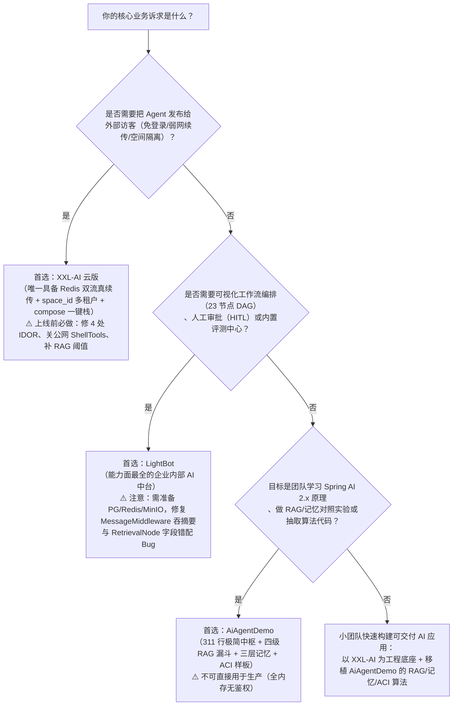

# 三项目对标总表 v2.0（源码级深度核查与勘误版）
## XXL-AI × LightBot × AiAgentDemo

| 项 | 内容 |
|---|---|
| 文档版本 | **v2.0（源码级深度核查 + 跨 9 份文档全量勘误终版）** |
| 升级基线 | 基于 `docs/` 目录下 9 份 v1.0~v3.0 架构与评估文档，对照三套工程源码 + Maven 本地仓库字节码/源码包（`spring-ai-2.0.1`、`spring-ai-agent-utils-0.13.0`）逐行复核 |
| 对标对象 | **XXL-AI** 云版（`v1.1.2-SNAPSHOT`，HEAD `47aaaff`）、**LightBot**（`v2.1.0`）、**AiAgentDemo**（Spring AI `2.0.0-M4`） |
| 核心突破 | **清零 v1.0 中全部 4 处「需确认/需实测/未核实」悬念**；**纠正 9 份前序文档中 22 处事实偏差、概念张冠李戴与统计乌龙**；**新发现 4 处隐藏代码级 Bug** |
| 使用方式 | 选型决策看 **第 0 / 11 / 13 章**；跨文档勘误看 **第 1 章**；模块与机制评审看 **第 2–10 章**；架构改造路线看 **第 12 章** |
| 一句话结论 | **XXL-AI 是「能发布」（运行时双流解耦），LightBot 是「能编排」（23 节点 DAG + 自管 ReAct 证据链），AiAgentDemo 是「能讲清」（四级 RAG 漏斗 + 三层记忆 + ACI 自愈）。三者不是同维竞品，而是把工程复杂度放在了三个正交维度上。** |

---

## 0. 核心结论

### 0.1 三条技术路线总览

| 项目 | 一句话定位 | 复杂度放在哪 | 最强的一件事（源码级护城河） | 最弱的一件事（源码级短板） |
|---|---|---|---|---|
| **XXL-AI** | 面向外部访客的 Agent 发布底座 | **运行时管道**（生成/连接解耦、真续传、空间多租户） | `ChatStreamTool` Redis Stream 双流解耦：生成脱离 HTTP 连接存活，刷新/跨节点从 `lastEventId` 真续传 | 智能质量层单薄：RAG 无相似度阈值、无多路融合/精排、无工具证据表、无主动中止（Stop） |
| **LightBot** | 企业内部的 AI 编排与治理中台 | **平台能力面**（Workflow、混合检索、评测、版本快照、Trace） | 23 节点 DAG 工作流 + HITL 人工确认 + `ChatServiceImpl` 自管 ReAct 递归循环与 `tool_calls` 证据链 | 对话与 `Flux` 连接强绑定（断线即触发 `CLIENT_DISCONNECT` 中止生成，仅支持 100 条滑动窗口回放），5 中间件无 compose 部署重 |
| **AiAgentDemo** | Spring AI 2.x 算法与上下文试验田 | **算法可解释性**（每环节独立类、可开关对照实验） | 四级 RAG 漏斗（3 路召回 + RRF + 智谱 Rerank）+ 三层 `ChatMemory` + `AciResponse` 自愈协议 | 纯内存单机 Demo（`VectorStore` 为 `ArrayList` 线性扫描），无数据库、无登录鉴权、无断线恢复 |

### 0.2 三句话选型记法

1. **要发布给不受控的外部访客用 → 选 XXL-AI。** 它是三者中唯一把「Redis Stream 断线真续传 + `space_id` 空间多租户 + UUID 免登录公开访问」做进运行时的。
2. **要让业务人员画复杂流程与人工审批 → 选 LightBot。** 它是三者中唯一具备可视化 23 节点 DAG 引擎、HITL 暂停恢复、版本快照与 12 表评测体系的。
3. **要搞懂 Agent 每一步为什么这么走、或者抽算法组件移植 → 选 AiAgentDemo。** 它是三者中唯一把检索漏斗、记忆压缩、ACI 诊断拆成最小独立对象并配齐对照实验的。

### 0.3 v2.0 修正后的核心认知

`v1.0` 曾断言「XXL-AI 的工程最成熟，但智能质量层完全为空（无轮次熔断、无 Skill 懒激活、无出处）」。经 v2.0 深入字节码与源码包核查，这一判断需修正为更精确的工程事实：

- **XXL-AI 并非「无工具轮次上限」与「无 Skill 懒激活」**：
  - 其依赖的 `spring-ai-model:2.0.1` 在 `DefaultToolCallingManager` 中已内置默认熔断（**单工具 40 次 / 单轮总计 150 次**）；
  - 其依赖的 `spring-ai-agent-utils:0.13.0`（`SkillsTool`）在工具描述中**仅注入 YAML front-matter（`name + description`）**，模型调用 `Skills` 工具时才按需读取 `SKILL.md` 正文——**单轮内已具备标准渐进披露（懒激活）**！
- **XXL-AI 真正的质量短板在于「跨轮次状态丢失」与「RAG 裸检索」**：因为 `xxl_ai_chat_msg` 不存 `tool_calls`/`ToolResponseMessage`，上一轮激活的 `SKILL.md` 与工具证据在下一轮即失忆；而 `RagTool` 仅做无阈值向量 Top-K 召回，且 `QuestionAnswerAdvisor` 默认模板丢弃全部文档元数据。

---

## 1. v1.0 → v2.0 源码级深度勘误总表（跨 `docs/` 9 份文档）

> 本章专门针对 `docs/` 目录下 9 份文档（`三项目对标总表-v1.0`、`XXL-AI v1.0/v2.0/v2.1/v3.0`、`XXL-AI 系统评估 v1.0`、`LightBot v2.1`、`LightBot 系统评估 v1.0`、`AiAgentDemo v1.0`）中的**未决悬念、事实错误、概念混淆与新发现 Bug** 进行集中纠偏。每条结论均附精确源码文件、行号或反编译证据。

### 1.1 彻底揭晓 `v1.0` 中的 4 大「需确认 / 需实测 / 未核实」悬念

| 编号 | `v1.0` 悬念位置 | 前序文档说法 | v2.0 源码/字节码实测真相 | 精确代码证据 |
|---|---|---|---|---|
| **S-01** | 第 4 章 L125<br/>（XXL-AI 轮次熔断） | "未配置（依赖框架默认，**需确认** 2.0.1 是否支持 `limits`）"；`XXL-AI v1.0` T06 建议直接配 `spring.ai.tools.limits.*` | **1. Spring AI `2.0.1` 已正式支持 `ToolCallLimits`（`@since 2.0.1`）与 `spring.ai.tools.limits.*` 配置**（而 AiAgentDemo 的 `2.0.0-M4` 尚未引入该类）。<br/>**2. 框架默认并非无限循环**：`DefaultToolCallingManager` 默认限制**单工具单轮最多 `40` 次（`DEFAULT_MAX_CALLS_PER_TOOL = 40`）、单轮总调用最多 `150` 次（`DEFAULT_MAX_TOTAL_TOOL_CALLS = 150`）**，超限抛异常（`THROW`）。<br/>**3. 关键陷阱**：`LlmModelFactory#chatModel` 手动调用 `OpenAiChatModel.builder().options(options)...build()`，**未注入 Spring 容器的 `ToolCallingManager` Bean**！因此在 `application.properties` 中配置 `spring.ai.tools.limits.*` **对 XXL-AI 完全无效**，始终走硬编码默认值 40/150。 | `spring-ai-model-2.0.1-sources.jar`:<br/>`DefaultToolCallingManager.java` L99-106, L375-465；<br/>`ToolCallLimits.java` L36-135；<br/>`LlmModelFactory.java` L79-82 |
| **S-02** | 第 4/5/14 章 L129, L152, L365<br/>（XXL-AI Skill 懒激活） | 6 份文档均断言 XXL-AI "全量注册 `SKILL.md` / Skill 懒激活：`❌`（依赖 `spring-ai-agent-utils 0.13.0`，**需实测**）" | **重大误判纠正：XXL-AI 单轮内已具备标准渐进披露（懒激活）！**<br/>反编译 `spring-ai-agent-utils-0.13.0-sources.jar` 可见：`SkillsTool.builder().addSkillsDirectory(root)` 构建 `Skills` 工具描述时，调用 `Skill#toXml()` **仅序列化 YAML front-matter（`<name>`、`<description>` 等），绝不把 `SKILL.md` 正文拼入系统提示或工具描述**；仅当模型主动调用 `Skills(command="xxx")` 工具时，`SkillsFunction` 才返回技能目录路径与 `SKILL.md` 全文。<br/>**真正的差距**：① `SkillToolFactory#buildExecutorTools` 无条件挂载 5 套执行工具（未按激活状态懒解锁）；② 因 `xxl_ai_chat_msg` 不落库 `ToolResponseMessage`，已读入的 `SKILL.md` 正文在下一轮对话中失忆。 | `spring-ai-agent-utils-0.13.0-sources.jar`:<br/>`SkillsTool.java` L44-66, L188-214；<br/>`Skills.java` L293-300；<br/>`SkillToolFactory.java` L124-137, L178-180 |
| **S-03** | 第 6 章 L173<br/>（XXL-AI RAG 上下文出处） | "未显式标注（依赖 Advisor 默认模板，**需确认**）" | **实测确认：完全无出处标注（`❌`）。**<br/>1. 解压 `spring-ai-vector-store-advisor-2.0.1-sources.jar`：`QuestionAnswerAdvisor#before()`（L125-127）通过 `documents.stream().map(Document::getText).collect(Collectors.joining(System.lineSeparator()))` 构造 `{question_answer_context}`，**只拼纯文本，完全丢弃 `Document#getMetadata()`**。<br/>2. `RagTool#buildDocument`（L351-356）写入 Milvus 的 metadata 仅有 `docId` 与 `chunkIndex`，**连文档标题 `docTitle` 都没写入向量库**。<br/>3. `LlmChatTool#stream`（L112-137）也完全忽略了 `ChatResponse` metadata 中的 `qa_retrieved_documents`。 | `spring-ai-vector-store-advisor-2.0.1-sources.jar`:<br/>`QuestionAnswerAdvisor.java` L60-73, L125-127；<br/>`RagTool.java` L252-264, L351-356 |
| **S-04** | 第 6 章 L173<br/>（LightBot RAG 上下文出处） | "未核实（需查模板）" | **实测确认：Agent 工具链路 `✅ 有出处`，但 Workflow 节点链路 `❌ 无出处且有字段名错配 Bug`！**<br/>1. **Agent 工具链路（`QueryKnowledgeTool`）**：普通分片命中时，返回给模型的 JSON 含 `document_id`、`document_name`、`knowledge_id`、`score`、`content`（仅剥离 `chunk_id` 留作前端 `[METADATA]` 引用卡片），且 `MessageMiddleware` 系统提示明确要求模型在回答末尾标注文档名；但**高分 QA 对直出分支**（阈值 `0.9`）仅返回 `qa_answer`，无文档名。<br/>2. **Workflow 节点链路（`RetrievalNodeProcessor`）**：`retrievalResult` 仅用 `\n\n` 拼纯正文；且组装 `retrievalChunks` 时读取 `hit.get("document_title")`，而检索层写入的 key 实际为 `"document_name"`，导致 **`documentTitle` 永远为 `null`（真实 Bug）**！ | `QueryKnowledgeTool.java` L220-277；<br/>`MessageMiddleware.java` L114-118, L152；<br/>`RetrievalNodeProcessor.java` L106-126；<br/>`EmbeddingMapper.java` L59, L82, L134 |

### 1.2 跨 9 份文档的 18 项事实错误、概念混淆与新发现代码 Bug

| 编号 | 涉及项目 | 错误出现在哪些文档 | 文档原说法 | 源码真实情况（含新发现 Bug） | 精确代码位置 |
|---|---|---|---|---|---|
| **E-01** | **LightBot** | `总表 v1.0` L151, L372<br/>`LightBot 评估 v1.0` L27, L58<br/>`XXL-AI v2.1` L37 | 把 `TokenBudgetService` 列入第 5 章「记忆与上下文治理」，称其为 Prompt 上下文窗口 Token 预算控制 | **概念张冠李戴 + 发现未接线漏洞**：<br/>1. `TokenBudgetService` 是基于 Redis 的**用户/全局每日 Token 消费配额与排行榜服务**（`lightbot:token_budget:user:{id}:{date}`，默认单用户 100 万/天、全局 1000 万/天），**根本不是 Prompt 上下文窗口裁剪器**！<br/>2. 更严重的是：**`ChatServiceImpl` 全文从未调用 `tokenBudgetService.checkBudget()`**，仅在生成结束后调用 `recordUsage()` 事后记账（L168, L451）！只有评测模块 `EvalChatServiceImpl`（L61, L118）调用了 `checkBudget`。 | `TokenBudgetService.java` L1-363；<br/>`ChatServiceImpl.java` L168, L451；<br/>`EvalChatServiceImpl.java` L61, L118 |
| **E-02** | **LightBot** | `总表 v1.0` L149, L371<br/>`LightBot v2.1` §4.4 | 称 LightBot "无明显摘要 / 记忆摘要：`❌`" | **事实遗漏 + 发现严重吞摘要 Bug**：<br/>1. `MessageMiddleware#summarizeIfNeeded`（L532, L799-896）**已经实现了历史摘要压缩**！当 `enableSummary=true`、历史总字符 `> thresholdKb`（默认 `100KB`）且条数 `> keepRecent + 2`（默认保留 6 条）时，会下发 `[STATUS] context_compression`，同步调用 LLM 生成摘要并构造 `MessageRole.SYSTEM` 的 `summaryMsg` 放在 `history` 队首。<br/>2. **新发现严重 Bug**：紧接着在 L540-548 将 `history` 转为 Spring AI `Message` 时，`if-else` **只处理了 `USER` 和 `ASSISTANT`，漏掉了 `MessageRole.SYSTEM`**！导致刚花 Token 生成的 `summaryMsg` 被静默丢弃，实际发给模型的只有最近 6 条消息！ | `MessageMiddleware.java` L532, L540-548, L799-896 |
| **E-03** | **LightBot** | `LightBot v2.1` L235 | "单请求事件缓冲 100 条：超出即不再缓冲，重连只能拿到**前 100 条**" | **淘汰方向写反**：`SseEventBuffer#record`（L42-46）逻辑为 `if (ctx.events.size() >= MAX_EVENTS) { ctx.events.remove(0); } ctx.events.add(...)`——超出 100 条时淘汰的是**最早的队首事件（`remove(0)`）**，保留的是**最近 100 条滑动窗口**（含 `[DONE]`），而非前 100 条。 | `SseEventBuffer.java` L17-20, L42-46 |
| **E-04** | **LightBot** | `XXL-AI v2.0` L21, L45, L75, L141, L644<br/>`LightBot 评估 v1.0` L245 | 称 LightBot 工作流为 "22 个具体处理器"（与 `v2.1` 的 23 个自相矛盾） | **实测确认为 23 种 `NodeType` 枚举 + 23 个具体处理器**：其中 **22 个**位于 `lightbot-workflow/.../processor/`，第 **23 个** `AppComponentNodeProcessor`（对应 `NodeType.APP_COMPONENT`）因为需要注入 `AgentService`/`ChatService`/`WorkflowService`，为绕开模块循环依赖被放在了 `lightbot-agent/.../workflow/processor/`。只扫 `lightbot-workflow` 目录会漏掉第 23 个。 | `NodeType.java` L19-41；<br/>`AppComponentNodeProcessor.java` L1-45 |
| **E-05** | **LightBot** | `XXL-AI v2.0` L9, L44, L643 | 称 LightBot 有 "48 张表"（与 `v2.1` 的 47 张表矛盾） | **实测确认为 47 张表**：`LightBot/sql/2026-07-28-init.sql` 中精确包含 **47 个** `CREATE TABLE` 语句，其余增量脚本（`2026-10-06-001.sql`、`insert-sql.sql`）无建表语句。 | `LightBot/sql/2026-07-28-init.sql` |
| **E-06** | **LightBot** | `总表 v1.0` L166<br/>`LightBot v2.1` §5 | 称检索三模式为 `vector / fulltext / hybrid`；称 GraphRAG 可独立作为知识库增强 | **1. 模式名纠正**：`EmbeddingServiceImpl`（L54-56）定义的常量是 **`vector / keyword / hybrid`**（若传 `"fulltext"` 会落入 `default` 退化为纯向量检索 `vector`）！<br/>**2. GraphRAG 隐性耦合**：`EmbeddingServiceImpl#enhanceWithGraphSearch`（L534）首行判断 `if (!useGraph \|\| !shouldRouteToMilvus(knowledgeId)) return results;`，即 **Neo4j 图谱增强仅对 `MILVUS` 类型知识库生效**，默认的 `PGVECTOR` 知识库即便开启 `useGraph` 也会被直接跳过！ | `EmbeddingServiceImpl.java` L54-56, L375-425, L534 |
| **E-07** | **LightBot** | `LightBot v2.1` §4.5 | 称 `SkillPrepMiddleware` 在技能激活后把完整 `SKILL.md` 与额外工具注入上下文 | **职责归属偏差**：`SkillPrepMiddleware`（L102-134）无论技能是否激活，在 `skillSystemAppendix` 中**始终只拼摘要（名称+版本+描述+关联工具名）**，且 `ctx.skillExtraToolIds`/`skillExtraMcpServerIds` 是未使用的空列表；真正对 `ctx.getActivatedSkills()` 求依赖闭包（`expandSkillClosure`）并动态解锁关联 Tool/MCP 的是 **`ToolPrepMiddleware`**（L175-187, L231-242）！此外 `SkillPrepMiddleware` L122 只打印 `skill.getName()` 未打印 `slug`，而 `ReadSkillTool` L61 按 `slug` 匹配，当中文 `name != slug` 时模型易传错参数。 | `SkillPrepMiddleware.java` L102-134；<br/>`ToolPrepMiddleware.java` L175-187, L231-242；<br/>`ReadSkillTool.java` L61 |
| **E-08** | **LightBot** | `LightBot v2.1` §6.1 | 称 Python 脚本走 GraalVM Python 沙箱或回退宿主机进程 | **默认构建 100% 走宿主机裸进程**：`lightbot-tool/pom.xml`（L58-67）中 `org.graalvm.python:python-language` 依赖**已被注释掉**（注有“按需启用，体积较大 ~200MB”），因此默认构建下 `GraalVmPythonEngine.isAvailable()` 恒为 `false`，Python 执行 100% 落入 `PythonEngine`（`ProcessBuilder("python3"/"python")` 宿主机子进程）。 | `lightbot-tool/pom.xml` L58-67；<br/>`EngineRegistry.java` L47-55 |
| **E-09** | **LightBot** | `总表 v1.0` L47, L261 | 称 LightBot "14 个测试类（集中在任务/调度）" | **补充精确量化**：14 个测试类共 **91 个 `@Test` 方法**，其中 5 个任务队列测试类（`TaskQueueServiceImplTest` 等）占了 **66 个 `@Test`（72.5%）**；其余 9 个测试类（含 1 个集成测试 `SystemIntegrationTest`）共 25 个 `@Test`。2,504 行的 `ChatServiceImpl` 确实 **0 单测**。 | `LightBot/**/src/test/java` |
| **E-10** | **AiAgentDemo** | `总表 v1.0` L47, L250, L261, L272, L388<br/>`AiAgentDemo v1.0` L6, L62, L523, L612<br/>`XXL-AI v3.0` L9, L59, L73, L596 | 全部文档一致声称 "7 个测试类 / **26 个 `@Test`**" | **统计乌龙纠正：实际只有 21 个 `@Test` 方法！**<br/>原文档作者执行 `grep -rh "@Test" src/test \| wc -l` 得到 26，是因为把 5 个测试类头部的 **`@TestMethodOrder(MethodOrderer.OrderAnnotation.class)`** 误算成了 `@Test`！7 个测试类的真实 `@Test` 分布为：`ChatMemoryTest`(3) + `SubAgentFunctionCallingTest`(3) + `RagScenariosVerificationTest`(5) + `ToolFunctionCallingTest`(5) + `McpGaodeFunctionCallingTest`(3) + `LoggingConfigTest`(1) + `AiAgentDemoApplicationTests`(1) = **21 个**。 | `aiagentdemo/src/test/java` 全部 7 个测试类 |
| **E-11** | **AiAgentDemo** | `总表 v1.0` L129, L152, L365<br/>`AiAgentDemo v1.0` L388, L459 | 称其为 "`resources/skill/**/SKILL.md` 领域操作手册，由模型决定是否读取 / Skill 懒激活：`⚠️ 部分`" | **严重失实：既无 `SKILL.md`，也无任何懒激活！**<br/>1. `SkillManager.java`（L64）扫描的是 `classpath:skill/*.md` 下的 **7 个平铺 Markdown 文件**（`api_doc_generator.md`、`code_explain.md`、`code_review.md`、`sql_generator.md`、`summarize.md`、`tech_trivia.md`、`translate.md`），无任何 `SKILL.md`。<br/>2. `SkillTool.java`（L35-71）在启动时将 **7 个技能全量注册为 7 个独立 `ToolCallback`（`skill_translate` 等）**，且调用时是将 `{{param}}` 替换进 `promptTemplate` 后，在工具内部同步发起一次**嵌套 LLM 调用**（`chatClient.prompt().user(prompt).call().content()`，L68）！它本质是「Prompt 模板子调用工具」，而非渐进披露技能手册。 | `SkillManager.java` L64-120；<br/>`SkillTool.java` L35-71 |
| **E-12** | **AiAgentDemo** | `AiAgentDemo v1.0` L385, L406, L413<br/>`XXL-AI v3.0` L57, L74 | 称 "仅 `GetStockPriceTool` 接入 `AciResponse`，`GetWeatherTool` 返回普通字符串"；称诊断字段为 `action` | **事实错误**：<br/>1. `GetWeatherTool.java`（L45, L53, L61）**同样完整使用了 `AciResponse.error` 与 `AciResponse.ok`**（仅比 `GetStockPriceTool` 少演示了 `AciResponse.retry` 分支）！<br/>2. `AciResponse.AciDiagnostic`（L97-101）的真实字段名是 **`suggestedAction`**（`errorCode`、`reason`、`suggestedAction`、`example`），而非 `action`。 | `GetWeatherTool.java` L45, L53, L61；<br/>`GetStockPriceTool.java` L42-91；<br/>`AciResponse.java` L97-101 |
| **E-13** | **AiAgentDemo** | `AiAgentDemo v1.0` L387 | 称 `SubAgentTool` 暴露 4 个工具（`create` / `chat` / `list` / `destroy`） | **多算 1 个工具**：`SubAgentTool.java`（L35-41）仅注册了 **3 个** `ToolCallback`（`create_sub_agent`、`chat_with_sub_agent`、`destroy_sub_agent`）。`SubAgentManager#listActiveAgents()`（L100）并未暴露为 Tool，属死代码。 | `SubAgentTool.java` L35-41；<br/>`SubAgentManager.java` L100 |
| **E-14** | **AiAgentDemo** | `XXL-AI v3.0` L51 | 称 `VectorStore` 为 "内存 `ConcurrentHashMap`" | **数据结构写错**：`VectorStore.java`（L18-21）底层是两个非线程安全的 **`ArrayList`**（`List<DocumentWithVector> documentVectors = new ArrayList<>()` 与 `List<Document> documents = new ArrayList<>()`），无 `ConcurrentHashMap`。 | `VectorStore.java` L18-21 |
| **E-15** | **AiAgentDemo** | `AiAgentDemo v1.0` L156, L204, L278<br/>`XXL-AI v3.0` L171 | ① 称 `TextSplitter` 四级切分为 `## → ### → \n\n → \n`；<br/>② 称 `QueryRewriteRetriever` 固定输出 10 条；<br/>③ 称 `Bm25Retriever` 每次分词 2 遍；<br/>④ 称 `ChatMemory` L1 未处理连续 `TOOL` 消息 | **4 处算法细节纠偏**：<br/>① `TextSplitter`（L34-40, L85-121）真实四级为：**标题正则（`#{1,6}\s.+` 或 `第X章/节/部分/篇`）→ 段落 `\n\n+` → 句末标点 `(?<=[。！？!?])` → 固定字符窗 `chunkSize`**；<br/>② `QueryRewriteRetriever`（L35-54）**忽略了入参 `topK`**，对 3 条子查询各取 Top 10 去重合并，实际返回 **10~30 条**；<br/>③ `Bm25Retriever`（L47, L54, L64）每次检索对全量文档重复分词 **3 遍**（算 `avgdl` 1 遍 + 算 `df` 1 遍 + 打分算 `tf` 1 遍）；<br/>④ `ChatMemory` L1（L142-145）用的是 **`while` 循环回退**，已正确处理连续多条 `TOOL` 消息；真正未成对处理 `TOOL` 的是 **L2 非对称裁剪**（`getMessages` L116-122 只跳过旧 `ASSISTANT` 未跳过关联 `TOOL`）。 | `TextSplitter.java` L34-40, L85-121；<br/>`QueryRewriteRetriever.java` L35-54；<br/>`Bm25Retriever.java` L47-64；<br/>`ChatMemory.java` L116-145 |
| **E-16** | **AiAgentDemo** | `AiAgentDemo v1.0` L280, L500 | ① 称 `switchModel` 仅漏更新 `ChatMemory`；<br/>② 称仅 `application.properties` 有 1 处明文 Key | **影响面扩大**：<br/>① `AgentCore#switchModel`（L98-121）不仅漏更新已有 `ChatMemory.chatClient`，还漏更新了 **`IntentRecognizer.chatClient`、`SkillTool.chatClient`、`QueryRewriteRetriever.chatClient`、活跃 `SubAgent.chatClient`**，且完全忽略了 `ModelConfig` 中的 `embeddingModel`；<br/>② 除 `application.properties:5` 的智谱明文 Key 外，`src/main/resources/data/mcp-servers.json:2` 与 `McpGaodeFunctionCallingTest.java:41` 还硬编码了**高德 MCP 明文 Key**。 | `AgentCore.java` L98-121；<br/>`mcp-servers.json` L2 |
| **E-17** | **XXL-AI** | `总表 v1.0` L47, L261-262 | 称 XXL-AI "3 个测试类 / 核心链路测试：无（对话/RAG/工具无单测）" | **事实更新**：`xxl-ai-api/src/test/java` 现有 4 个 `.java` 文件（3 个测试类 + 1 个 `package-info.java`），共 **28 个 `@Test` 方法**（`AgentSkillExecutionTest` 10 个 + `LoginControllerTest` 4 个 + `RedisCacheUtilTest` 14 个）。其中 `AgentSkillExecutionTest` 实测了 `LlmChatTool.chat`、`SkillToolFactory` 沙箱落盘、`McpClientTool` Windows stdio 自动兼容等核心链路（但依赖本地环境，且 `pom.xml` 与 CI 设了 `maven.test.skip=true`）。 | `AgentSkillExecutionTest.java` L1-405；<br/>`LoginControllerTest.java` L1-62；<br/>`RedisCacheUtilTest.java` L1-167 |
| **E-18** | **XXL-AI** | `XXL-AI v3.0` L159-165 | 称 `RagTool.split` 按 `[。！？.!?]` 切句导致 `"Spring Boot 2.0.1"` 被切成 `"2." / "0." / "1"` | **张冠李戴**：XXL-AI 当前 `RagTool#split`（L361-379）是**纯字符滑窗 `content.substring(start, end)`**，根本没有任何标点正则切句逻辑！把 `"2.0.1"` 按句号切碎的是 **AiAgentDemo 的 `SentenceSplitter.java`**，而非 XXL-AI 的 `RagTool`。 | `RagTool.java` L361-379 |

---

## 2. 基础画像与技术栈对标（100% 源码实测值）

### 2.1 工程规模与交付形态

| 维度 | XXL-AI（云版） | LightBot（v2.1.0） | AiAgentDemo |
|---|---|---|---|
| **Java 文件总数** | **167 个**（`xxl-ai-api` 160 main + 4 test；`xxl-ai-sample` 3 main） | **735 个**（721 main + 14 test） | **53 个**（46 main + 7 test） |
| **Java 代码总行数** | **17,648 行**（`api` 17,460 行 + `sample` 188 行；`wc -l` 换行符口径为 17,369 行） | **95,120 行**（main 92,766 行 + test 2,354 行；`wc -l` 为 95,101 行） | **6,194 行**（main 5,271 行 + test 923 行） |
| **数据库表数量** | **15 张**（MySQL，`doc/db/tables_xxl_ai.sql`） | **47 张**（PostgreSQL，`sql/2026-07-28-init.sql`） | **0 张**（全内存态，仅 `mcp-servers.json` 落盘） |
| **前端工程规模** | **57 Vue + 66 TS**（`xxl-ai-ui`，Vue 3 + Element Plus + Vite，Hash 路由）<br/>*注：同仓另有桌面端 `xxl-ai-desk`（14 Vue + 45 TS），不在云版范围* | **266 Vue**（`lightbot-web`，Vue 3 + Ant Design Vue + Vue Flow，History 路由） | **2 个静态页 + 4 个 JS**（`static/index.html`、`rag.html`，原生 JS，无构建） |
| **Maven 模块数** | **2 个后端模块**（`xxl-ai-api`、`xxl-ai-sample`）+ 前端目录 `xxl-ai-ui` | **9 个模块**（`common` / `platform` / `ai` / `knowledge` / `tool` / `mcp` / `workflow` / `agent` / `server`） | **1 个单体模块** |
| **运行端口** | `8080`（API 与内嵌前端同端口）；`8091`（`xxl-ai-sample`） | `8081`（后端 API）；前端独立部署 | `8080`（Spring Boot 默认端口） |
| **一键部署能力** | **有 `docker-compose.yml`**（一键拉起 mysql / redis / milvus / etcd / minio / attu / api / sample 8 容器） | **无 `docker-compose.yml`**，需手工准备 PG(pgvector) + Redis + MinIO（Neo4j / Milvus 可选） | **无**，直接 `mvn spring-boot:run` |
| **CI 流水线** | **有**（`.github/workflows/maven.yml`），但 `pom.xml:26` 设了 `<maven.test.skip>true</maven.test.skip>`，**CI 不跑测试** | **无**（无 `.github/workflows`） | **无**（无 `.github/workflows`） |
| **测试真实规模** | **3 个测试类 / 28 个 `@Test`**（含 `AgentSkillExecutionTest` 10 个核心链路联调测试） | **14 个测试类 / 91 个 `@Test`**（其中 66 个即 **72.5%** 集中在 5 个任务队列测试类；对话主类 0 单测） | **7 个测试类 / 21 个 `@Test`**（前序文档误算为 26 个；全部聚焦记忆、检索漏斗、工具、MCP、SubAgent 核心机制） |

### 2.2 技术栈版本与选型

| 技术层 | XXL-AI | LightBot | AiAgentDemo | 对标点评 |
|---|---|---|---|---|
| **JDK** | 17 | 17 | **21** | AiAgentDemo 用了 JDK 21 |
| **Spring Boot** | `4.1.1`（注：仓内超前版本号） | `3.3.6` | `4.0.5` | XXL-AI 与 AiAgentDemo 属同代基线 |
| **Spring AI** | **`2.0.1`** | **`1.1.8`** | **`2.0.0-M4`** | **关键分水岭**：XXL-AI 与 AiAgentDemo 同为 2.x（API 兼容，可直接互植）；LightBot 为 1.1.8（包路径与 Advisor 接口不同，只能借设计） |
| **Agent 扩展库** | `spring-ai-agent-utils:0.13.0` | 自研中间件 + 自研 Tool 体系 | 自研 `InnerTool` + `SkillTool` + `SubAgentTool` | XXL-AI 直接复用社区 `SkillsTool`/`ShellTools`/`FileSystemTools` |
| **MCP SDK** | `io.modelcontextprotocol.sdk:mcp:2.0.1` | 官方 MCP SDK + 自封装 `McpClientManager` | `io.modelcontextprotocol.sdk:mcp:1.1.0` | 三者均基于官方 Java MCP SDK |
| **ORM 框架** | MyBatis `4.1.0`（纯 XML 显式映射） | MyBatis-Plus `3.5.9` + Jackson TypeHandler | 无 | XXL-AI 严守 XML 规范；LightBot 深度使用 JSONB 映射 |
| **认证鉴权** | `xxl-sso-core:2.4.1`（Redis 会话 + `@XxlSso`） | `Sa-Token:1.39.0` + OpenAPI Key | **无** | XXL-AI 与 LightBot 均有完整后台鉴权 |
| **向量存储** | **Milvus**（SDK `3.0.10`，`COSINE` + `FLAT`） | **pgvector**（`HNSW`）+ **Milvus**（双引擎路由） | **内存 `ArrayList`**（暴力余弦扫描） | LightBot 支持按知识库类型切换 pgvector/Milvus |
| **LLM 底层 HTTP** | **OkHttp**（`OpenAiHttpClientBuilderCustomizer` 拦截器改写 `User-Agent: XXL-AI`，未调超时） | Spring `RestClient` / Reactor Netty `WebClient` + JTokkit | Spring 默认客户端 + 原生 `java.net.http.HttpClient`（`LlmReranker` 15s 超时） | XXL-AI 的流式调用受底层 OkHttp 默认读超时约束 |

---

## 3. 架构分层与模块治理对标

| 维度 | XXL-AI | LightBot | AiAgentDemo |
|---|---|---|---|
| **分层哲学** | **职责严明的三域分层**（单模块内）：<br/>`framework`（底座）+ `business/{module}`（业务 CRUD 与全部 Controller 入口）+ `harness`（运行时支撑层） | **按能力切分的 9 模块多工程**：<br/>`common` → `platform` → `ai` → `knowledge/tool/mcp` → `workflow` → `agent` → `server` | **教学向扁平四包结构**：<br/>`core`（编排与记忆）+ `service.rag`（四级漏斗）+ `service.tool`（工具/Skill/MCP/SubAgent）+ `api` |
| **架构铁律与执行度** | **`harness` 零 Controller 铁律 100% 兑现**：`harness` 下 9 个核心类无一使用 `@RestController`，所有对外入口均在 `business/{module}/controller` | **存在 3 条跨层/反向耦合边**：<br/>① `lightbot-ai` 依赖 `lightbot-platform`；<br/>② `lightbot-agent` 越过 `workflow` 直接依赖 `knowledge/tool/mcp`；<br/>③ `WorkflowExecutorImpl` 与第 23 个节点 `AppComponentNodeProcessor` 为躲避循环依赖被迫寄生在 `lightbot-agent` | 无架构隔离约束：`AgentCore` 既管模型切换、又管意图识别、RAG 拼接、工具去重与 SSE 转换 |
| **核心编排类体积** | `ChatStreamTool.java`：**716 行**（含生命周期、双流读写、SSE 转发、生成装配）<br/>`LlmChatTool.java`：**177 行** | `ChatServiceImpl.java`：**2,504 行**（超级上帝类）+ `ChatContext`（60+ 字段可变上下文）+ 8 级 `ChatMiddleware` | `AgentCore.java`：**311 行**（极简清晰，一屏读懂全链路） |
| **二次开发心智负担** | **低~中**：新增业务只需按 `.agents/skills/xxl-ai/SKILL.md` 模板加 `business/{module}` + `XxlRoleEnum` 菜单项（零路由改动） | **高**：改一处对话逻辑需同时理解 8 级中间件顺序、`ChatContext` 60+ 字段副作用及 `ChatServiceImpl` 的 2,504 行递归分支 | **极低**：每个算法策略都是百行左右的独立类，适合做加减法实验 |

---

## 4. 对话运行时与流式机制对标（最大架构分水岭）

| 维度 | XXL-AI（`ChatStreamTool` + `LlmChatTool`） | LightBot（`ChatServiceImpl` + `ChatStreamSseHelper`） | AiAgentDemo（`AgentCore` + `ChatController`） |
|---|---|---|---|
| **流式架构模型** | **Redis Stream 双流解耦模型**：<br/>任务流 `xxl:ai:chat:tasks`（消费组 `xxl-ai-chat-workers`）+ 结果流 `xxl:ai:chat:result:{msgId}` | **Reactor `Flux` 直连 + 进程内双缓冲模型**：<br/>`SseEmitter` + Caffeine `SseEventBuffer` + `StreamProgressBuffer`（Redis + 内存兜底） | **Reactor `Flux<String>` 直通车**：<br/>`ChatClient.stream().content()` 直接映射为 `ServerSentEvent<String>` |
| **生成与 HTTP 连接关系** | **彻底解耦**：HTTP 请求只管 `XADD` 投递任务并开启 `XREAD` 转发线程；生成在后台守护 `worker` 线程中独立跑完 | **强绑定**：`ChatStreamSseHelper`（L144-169）在 `doOnCancel`（客户端断连）时立即调用 `abortRegistry.requestAbort(requestId, "CLIENT_DISCONNECT")` 中止后端生成！ | **强绑定**：浏览器关闭或刷新即取消底层 `Flux` 订阅，生成立即中断 |
| **断线续传 / 重连能力** | **✅ 真续传（跨节点无状态）**：<br/>前端持久化 `{convId, msgId, lastEventId}` 到 `sessionStorage`，刷新后调 `/chat/resume` 从 Redis 结果流 `lastEventId` 之后精确续读，**生成不中断、不丢一字** | **⚠️ 仅滑动窗口回放（需会话粘性）**：<br/>`SseEventBuffer`（Caffeine `maximumSize=5000`, `expireAfterWrite=5min`）按请求缓存**最近 100 条事件**（超出时 `remove(0)` 淘汰最旧事件）；重连调 `/chat/stream/reconnect/{requestId}` 重放缓冲事件，或调 `/chat/stream/progress/{sessionId}` 读已累积文本（Redis TTL 10min），但**断连后生成已停，无法续跑** | **❌ 完全不支持**：刷新页面即丢失当前流 |
| **流式消费阻塞方式** | `LlmChatTool#stream`（L112）使用 `chatResponses.toIterable()` **阻塞当前 worker 线程**逐帧消费并 `XADD` 写结果流 | 响应式 `Flux` 链式订阅，但在工具递归调用、RAG 检索、摘要生成处大量混用同步阻塞调用 | 响应式 `Flux` 订阅（但 `chatStream` 前置的 `IntentRecognizer`、`RagService`、`ChatMemory` L1 摘要均为同步阻塞） |
| **超时与心跳机制** | - 单次上限：`stream.timeout = 180,000ms`（3 分钟，但仅管 SSE 转发，**未中断底层 `toIterable()`**）<br/>- 心跳：每 **5 秒**（`READ_BLOCK_MILLIS = 5000` 空返回即发 `event: ping`）<br/>- 结果流 TTL：`stream.ttl = 600s`（10 分钟，半程节流续期） | - 单次上限：`SSE_TIMEOUT = 300_000L`（**5 分钟**，`ChatStreamSseHelper` L34 硬编码）<br/>- 心跳：每 **15 秒**（`HEARTBEAT_INTERVAL_SECONDS = 15`，发送 `:heartbeat` 注释帧） | - 单次上限：无显式控制<br/>- 心跳：**无** |
| **主动停止生成（Stop）** | **❌ 无后端中止接口**：前端点停止仅 `AbortController.abort()` 断开 SSE，后台 worker 仍继续调用模型直至结束（浪费 Token） | **✅ 完整中止链**：`POST /chat/stop/{requestId}` → `ChatAbortRegistry` 置位 → 取消 `Flux` 订阅 + `subagentExecutor.cancelByParentRequest(requestId)` 级联取消子代理 → **已生成的部分内容仍会通过 `saveFinalMessages` 落库** | **❌ 无** |
| **宕机恢复与任务治理** | Worker 每 60s（`RECLAIM_INTERVAL_MILLIS`）扫描 PEL 中空闲超 `streamTimeout + 60s`（240s）的任务并 `XCLAIM` 接管重跑；**但无最大重试次数与死信队列，且 `TASK_STREAM_MAXLEN = 5000` 近似裁剪无积压拒绝** | 对话流本身不进任务队列（宕机即断）；但异步任务模块（`lightbot_task_queue`）具备完整的指数退避重试、`next_retry_at`、30 分钟僵尸任务回收与 `DEAD` 死信状态 | **❌ 无** |
| **SSE 事件协议设计** | **标准命名事件（Named Events）**：<br/>`stream`（首帧传 `msgId`）/ `thinking` / `message` / `ping` / `done` / `error`，每帧带 Redis RecordId 作为 `id:` | **文本前缀协议（Payload Prefix）**：<br/>全部走默认 `data:`，靠字符串前缀区分：`[REQUEST_ID]{id}` / `[THINKING]{text}` / `[STATUS]{json}` / `[METADATA]{json}` / `[ERROR]{msg}` / `[DONE]` | **极简默认事件**：<br/>普通正文帧 + `[ERROR] xxx` 文本前缀 |
| **推理过程（Thinking）支持** | **✅ 原生支持**：`LlmChatTool`（L34, L119-128）提取 `metadata.get("reasoningContent")`，经 `computeReasoningDelta` 差量去重后下发 `thinking` 事件并落库 `xxl_ai_chat_msg.reasoning` | **✅ 原生支持**：识别推理内容并下发 `[THINKING]` 前缀帧，支持思考耗时统计 | **❌ 未处理**：仅提取 `.content()` 正文 |

---

## 5. 工具调用（Tool Calling）、MCP、Skill 与编排对标

| 维度 | XXL-AI | LightBot | AiAgentDemo |
|---|---|---|---|
| **ReAct 工具循环驱动方式** | **Spring AI 框架托管**：<br/>`ToolCallingAdvisor` / `DefaultToolCallingManager` 自动循环 | **业务层自管递归 ReAct 循环**：<br/>`ChatServiceImpl#processToolCallsRecursively` 手动设置 `internalToolExecutionEnabled(false)`，自行拦截 `toolCalls`、执行工具、发 SSE 状态、裁剪上下文并递归调模型 | **Spring AI 框架托管**：<br/>`ChatClient` 默认工具循环 |
| **循环轮次上限与超时** | **框架默认上限（40/150），无单工具超时**：<br/>`DefaultToolCallingManager` 默认单工具最多 **40 次**、总调用最多 **150 次**（注：`LlmModelFactory` 未注入 Spring Bean，配置文件改 `limits` 不生效）；MCP 调用固定 60s 超时，`ShellTools` 默认超时 | **双重硬熔断 + 截断 JSON 自动修复**：<br/>① `maxSteps`（Agent 可配，默认 **10 轮**，硬上限 **50 轮**）；<br/>② 单工具超时（默认 **30s**，硬上限 **300s**）；<br/>③ `repairTruncatedJson`（L1755-1823）自动补全因 `max_tokens` 截断的半截工具参数 JSON！ | **无轮次上限（`2.0.0-M4` 尚无 `ToolCallLimits`）**：<br/>`application.properties` 中 `spring.ai.tools.limits` 已注释；无单工具超时包装 |
| **工具调用过程前端可见性** | **❌ 黑盒不可见**：<br/>工具执行在 `LlmChatTool#stream` 的 `toIterable()` 内部阻塞完成，期间结果流无任何工具状态事件，前端只看到长达数秒~数十秒的空白等待（仅每 5s 收到 `ping`） | **✅ 全程实时可见**：<br/>每轮工具调用前后实时下发 `[STATUS] tool_call (started/completed/failed)` 与 `[METADATA]`（含 `toolBlockOffsets` 精确控制前端工具卡片在正文中的插入位置） | **❌ 前端不可见**：<br/>仅在后端控制台打印日志，SSE 流只输出最终回复正文 |
| **工具调用证据落库** | **❌ 完全不落库**：<br/>`xxl_ai_chat_msg` 仅存 `user` 与最终 `assistant` 消息，中间调了什么工具、入参返回值是什么，刷新页面或查库均无迹可寻 | **✅ 双重持久化**：<br/>① 独立表 `lightbot_tool_calls`（记录 `call_id`、`tool_name`、`arguments`、`result`、`status`、`duration_ms`）；<br/>② `lightbot_message.tool_events`（JSONB 冗余存储，刷新页面完美还原工具卡片） | **❌ 无数据库**（仅存在于内存 `ChatMemory` 的 `AssistantMessage` / `ToolResponseMessage` 中） |
| **工具失败自愈（ACI 范式）** | **❌ 裸抛异常**：<br/>`McpClientTool#callTool`（L94-102）无 `try-catch`，异常直接击穿生成流变 `error` 终态 | **⚠️ 有节点重试，无统一 ACI 诊断**：<br/>工具异常捕获后转错误字符串回传模型，但未结构化提供修复建议 | **✅ 标准 ACI 样板（`AciResponse`）**：<br/>`GetStockPriceTool` 与 `GetWeatherTool` 均返回 `{status, data, diagnostic: {errorCode, reason, suggestedAction, example}}`，引导模型自主换参重试 |
| **MCP 客户端实现对比** | **高可用缓存 + Windows/MySQL 深度兼容**：<br/>- 支持 `http`(Streamable HTTP) / `sse` / `stdio` 三传输；<br/>- 按 `mcpId + config` 指纹缓存复用 `McpSyncClient` 与 `tools/list`；<br/>- 工具名加 `{slug(mcpName)}__{toolName}` 防冲突；<br/>- **独有亮点**：`McpClientTool`（L287-330）内置 Windows 下 `npx/npm/.cmd` 自动转 `cmd.exe /c`、`/tmp` 自动映射本地有效目录、`@modelcontextprotocol/server-mysql` 自动纠偏为 `@benborla29/mcp-server-mysql` 并解析 `mysql://` 连接串！ | **池化管理 + 后台健康检查**：<br/>- 支持 `stdio` / `sse` / `streamable_http`；<br/>- `McpClientManager` 管理连接池与定时健康探活；<br/>- 支持在工作流中作为独立 `McpNodeProcessor` 节点调用 | **双协议自动回退（Fallback）+ JSON 落盘**：<br/>- `McpClient#connectToServer` 先试 `HttpClientStreamableHttpTransport`，失败自动回退 `HttpClientSseClientTransport`；<br/>- 配置持久化在 `data/mcp-servers.json` |
| **Skill 技能机制对比** | **DB 文件树物化 + `SkillsTool` 单轮懒激活 + 本地执行工具集**：<br/>- DB 表 `xxl_ai_skill` + `xxl_ai_skill_file` 存储多文件树；<br/>- 按 `skillId:updateTime` 指纹物化到 `{skill.root}/agent_{agentId}/{skillName}/`；<br/>- **`SkillsTool`（`0.13.0`）单轮内已实现 front-matter 摘要披露 + 按需加载 `SKILL.md` 正文**；<br/>- 配套挂载 `ShellTools`、`FileSystemTools`、`GlobTool`、`GrepTool`、`ListDirectoryTool`（无条件挂载，且跨轮失忆） | **多源安装 + 跨轮 Redis 懒激活 + 依赖闭包解锁**：<br/>- 支持上传 ZIP、GitHub 导入、在线编辑；<br/>- `SkillPrepMiddleware` 注入技能摘要，`ReadSkillTool` 按需读取 `SKILL.md` 并写入 Redis `SkillActivationStore`（TTL 24h）；<br/>- **`ToolPrepMiddleware` 对已激活技能求依赖闭包（`expandSkillClosure`），动态解锁该技能绑定的专属 Tool 与 MCP**！ | **平铺 Prompt 模板 + 工具内同步嵌套调 LLM（非真 Skill）**：<br/>- `classpath:skill/*.md` 7 个单文件模板；<br/>- `SkillTool` 启动时将 7 个文件全量注册为 7 个独立 `ToolCallback`；<br/>- 调用时替换 `{{param}}` 并**在工具内同步执行 `chatClient.prompt().user(prompt).call()`**（无渐进披露、无脚本执行） |
| **SubAgent 子代理** | **❌ 无** | **✅ 生产级多代理协同**：<br/>`SubagentExecutor` 独立线程池 + 单次最多 4 个并行 + 深度限制 + 事件桥接父流 + 级联取消 | **✅ 教学级 Agent-as-a-Tool**：<br/>`SubAgentTool` 暴露 3 个工具（`create` / `chat` / `destroy`），每个 `SubAgent` 拥有独立 `ChatMemory`（硬顶 40 条）并禁止递归挂载 `SubAgentTool` |
| **可视化工作流编排** | **❌ 无** | **✅ 23 节点 DAG 引擎 + HITL + Dify 兼容**：<br/>22 个 `lightbot-workflow` 处理器 + 1 个 `AppComponentNodeProcessor`；支持循环/批处理容器、`ConfirmNodeProcessor` 人工确认暂停恢复、Dify DSL 导入导出 | **❌ 无** |

---

## 6. 记忆与上下文工程对标

| 维度 | XXL-AI | LightBot | AiAgentDemo |
|---|---|---|---|
| **历史消息加载窗口** | **固定条数窗口（默认 50 条）**：<br/>`ChatStreamTool#generate`（L566）调 `chatMsgMapper.listRecentByConvId(convId, msgId, historyLimit)`，过滤未完成占位，仅组装 `UserMessage` 与 `AssistantMessage` | **条数窗口 + 8 级中间件装配**：<br/>`MessageMiddleware` 加载最近历史，组装系统提示、长期记忆、Todo 账本、技能摘要与多模态附件 | **L3 硬窗口（主 Agent 80 条 / 子 Agent 40 条）**：<br/>`ChatMemory` 按 `MAIN_AGENT_MAX_ROUNDS = 40`（即 80 条消息）、`SUB_AGENT_MAX_ROUNDS = 20`（40 条）截断 |
| **历史摘要压缩（L1）** | **❌ 无** | **⚠️ 有代码实现，但存在致命吞摘要 Bug**：<br/>`MessageMiddleware#summarizeIfNeeded`（L799-896）在历史字符 `> 100KB` 且条数 `> 8` 时调 LLM 生成摘要并存入 `MessageRole.SYSTEM`，**但 L540-548 转换消息列表时漏掉了 `SYSTEM` 分支，导致生成的摘要被直接丢弃**！ | **✅ 完整可用（增量滚动摘要）**：<br/>`ChatMemory` 在消息数 `> 15`（`COMPRESS_THRESHOLD_MESSAGES`）时，调用 `SummaryCompressor` 将早于最近 **5 条**（`PRESERVE_RECENT_MESSAGES`）的历史压成 `<=300` 字摘要，支持与旧摘要增量合并，以 `SystemMessage("【对话历史摘要】...")` 置顶 |
| **非对称裁剪 / 工具上下文裁剪（L2）** | **❌ 无**（实际上把所有中间 `tool_calls` 与 `ToolResponse` 全部丢弃了，只留最终 `assistant` 文本，属于"过度裁剪"） | **✅ 精细化工具上下文三级压缩（`ChatMessageContextUtil`）**：<br/>1. `compactLargeToolCallArgs`：压缩 `write_file`/`append_file` 的超大入参；<br/>2. 当工具上下文总字符 `> 60,000`（约 15K Token）时，`trimToolCallContext` 仅保留**最近 2 轮**（`TOOL_ROUNDS_TO_KEEP = 2`）完整工具对，将更早轮次替换为 `SystemMessage("[已省略第 1-N 轮工具调用详情...]")`；<br/>3. 若仍超限，`shrinkToolResponsePayloads` 按单条上限 `50,000` 字符截断；另设 `DASHSCOPE_SAFE_INPUT_CHARS = 180,000` 兜底。 | **⚠️ 仅主 Agent 保留最近 3 条 `ASSISTANT`（存在配对缺陷）**：<br/>`ChatMemory#getMessages`（L116-122）对主 Agent 仅保留最近 **3 条**（`MAIN_AGENT_MAX_ASSISTANT = 3`）`ASSISTANT` 消息，但未同步跳过更早轮次遗留的 `TOOL` 响应消息 |
| **`tool_calls` 成对边界保护** | 不涉及（不存 `tool_calls`） | **✅ 严格成对裁剪**：`ChatMessageContextUtil` 按 `(AssistantMessage[toolCalls], ToolResponseMessage)` 轮次成对替换 | **⚠️ L1 正确、L2/L3 有洞**：<br/>L1 摘要切分点用 `while` 循环回退跳过连续 `TOOL` 消息（L142-145）；但 L2 非对称裁剪与 L3 `trimIfNeeded` 直接按索引删头部，可能切出孤立 `TOOL` 消息 |
| **长期记忆与进度账本** | **❌ 无** | **✅ 双重具备**：<br/>- `user_memory` 表：对话后异步抽取用户偏好/事实并在 `MessageMiddleware` 注入；<br/>- `Todo` 进度账本：`WriteTodosTool` 维护多步任务状态机 | **❌ 无** |
| **Token 配额与预算管理** | **❌ 无** | **⚠️ 有 `TokenBudgetService`（每日消费配额），但主对话未拦截**：<br/>Redis 记录用户/全局每日 Token 消耗（默认 100 万/1000 万），但 `ChatServiceImpl` 仅调 `recordUsage` 记账，**未调 `checkBudget` 做事前拦截** | **❌ 无** |

---

## 7. RAG 检索增强全链路对标

| 维度 | XXL-AI（`RagTool`） | LightBot（`EmbeddingServiceImpl` + `QueryKnowledgeTool`） | AiAgentDemo（`RagService` + 四级漏斗） |
|---|---|---|---|
| **第 1 级：文档解析与分块（Chunking）** | **纯字符滑窗（`substring`）**：<br/>`RagTool#split`（L361-379）按 `chunkSize`（默认 500）/ `chunkOverlap`（默认 50）硬切字符，不认标题、段落与句号，必断词破句 | **递归字符切分 / 自定义分隔符**：<br/>支持 PDF/Word/Markdown/Excel 等多格式解析（Tika/POI），支持父子分段与 QA 问答对抽取 | **8 种 `ChunkSplitter` 实现（但 `RagService` 硬编码只用 `TextSplitter`）**：<br/>`TextSplitter(500, 50)` 按「标题正则 → `\n\n+` → 句末标点 `(?<=[。！？!?])` → 固定字符窗」四级递归切分 + overlap 回退；其余 7 个 Splitter（`Markdown`/`Code`/`Html`/`Json`/`Regex`/`Sentence`/`Character`）未接线 |
| **第 2 级：召回通道（Retrieval）** | **单路向量召回**：<br/>`MilvusVectorStore.similaritySearch`，`MetricType.COSINE` + `IndexType.FLAT`，默认 `topK = 5` | **三模式可配（`vector` / `keyword` / `hybrid`）+ QA 优先命中**：<br/>- `vector`：pgvector `<=>`（HNSW）或 Milvus；<br/>- `keyword`：PostgreSQL `to_tsvector('simple', content) @@ plainto_tsquery('simple', query)`；<br/>- `hybrid`：向量 + 全文双路并行；<br/>- 另有高分 QA 问答对优先直出（默认阈值 `0.9`） | **三路召回（`MultiRetriever`）**：<br/>① `SemanticRetriever`（向量余弦 Top 10）；<br/>② `Bm25Retriever`（内存 BM25，$k_1=1.5, b=0.75$，Top 10）；<br/>③ `QueryRewriteRetriever`（同步调 LLM 改写为 3 条子查询，各取 Top 10 去重合并为 10~30 条） |
| **第 3 级：多路融合（Fusion）** | **❌ 无** | **✅ 加权 RRF 融合**：<br/>`EmbeddingServiceImpl#fuseHybridResults`（L463-507），`RRF_K = 60`，默认向量权重 `0.7`、关键词权重 `0.3`：$$\text{score}(d)=\frac{w_{\text{vec}}}{60+r_{\text{vec}}}+\frac{w_{\text{kw}}}{60+r_{\text{kw}}}$$ | **✅ 等权 RRF 融合**：<br/>`MultiRetriever`（L29, L60-90），`RRF_K = 60`，三路等权累加 `1.0 / (60 + rank + 1)`，融合后截取 **Top 9**（`topK * 3`）送入精排 |
| **第 4 级：重排序（Rerank）** | **❌ 无** | **✅ 可选 Reranker（`RerankerUtil`）**：<br/>支持接入外部重排模型对候选集二次打分排序 | **✅ 智谱 Rerank API（`LlmReranker`）**：<br/>POST `https://open.bigmodel.cn/api/paas/v4/rerank`（15s 超时），将 9 条候选精排截取 **Top 3**；API 异常时优雅降级返回 RRF 前 3 条 |
| **相似度阈值过滤** | **❌ 无**：<br/>`RagTool#search`（L205-208）与 `#buildAdvisor`（L261-263）均只传 `topK`，未设 `similarityThreshold`，闲聊也必召回 Top-K 噪声 | **✅ 有**：<br/>知识库与检索节点支持配置 `similarity_threshold`（默认 `0.5`），SQL 与 Milvus 检索层直接过滤低分片段 | **❌ 无**：<br/>`VectorStore#similaritySearch`（L71-84）仅 `sorted().limit(topK)`，无阈值过滤 |
| **中文关键词检索能力** | **❌ 无关键词路** | **⚠️ 极弱**：<br/>PG `to_tsvector('simple', ...)` 按空格/标点切词，**对无空格连续中文整句视为单 Token**，中文关键词腿基本失效 | **⚠️ 半成品（单字切分）**：<br/>`Bm25Retriever#tokenize`（L93-112）将连续中文字符**逐字拆成单字 Token**（如 `"向量数据库"` → `["向","量","数","据","库"]`），虽有 IDF 压制高频字，但缺乏词级语义边界 |
| **触发方式与降级容错** | **绑库即查（无条件 Advisor）+ 单库故障降级**：<br/>只要 Agent 绑定了知识库，每轮对话必触发向量检索；若某知识库连接异常，`ChatStreamTool#buildAdvisors`（L646-651）捕获异常并写入 `【知识库降级】...` 到思考流，不中断主对话 | **三种触发方式**：<br/>① Agent 自主决定是否调用 `query_knowledge` 工具（最省 Token）；<br/>② 对话预处理自动检索；<br/>③ 工作流 `RetrievalNodeProcessor` 节点 | **意图识别触发 + 隐式/显式双检索冗余 Bug**：<br/>`AgentCore#chatStream` 先调 `IntentRecognizer`（同步 LLM 分类），若判定需检索则调用 `ragService.query` 拼入 UserMessage，但**同时又把 `knowledge_search` 工具挂进了 `ChatClient`**，导致模型可能再调一次检索工具！ |
| **上下文出处与前端引用卡片** | **❌ Prompt 与前端均无出处**：<br/>`QuestionAnswerAdvisor` 仅拼 `Document::getText`；`RagTool` 未存 `docTitle`；SSE 无引用事件 | **✅ Agent 工具路有出处 + 前端 `[METADATA]` 引用卡片**（但 Workflow 节点路无出处且 `document_title` 键名写错为 `null`） | **❌ 无出处**：<br/>`RagService#query`（L95-115）仅拼 `[1] content`，未将 `Document.metadata` 中的 `source` 与 `chunkIndex` 拼入 Prompt |
| **知识图谱（GraphRAG）** | **❌ 无** | **⚠️ 可选 Neo4j 图谱增强（`GraphRetrievalUtil`）**：<br/>但 `EmbeddingServiceImpl` L534 限制了**仅对 `MILVUS` 类型知识库生效**，`PGVECTOR` 库无法触发 | **❌ 无** |

---

## 8. 数据模型与多租户隔离对标

| 维度 | XXL-AI | LightBot | AiAgentDemo |
|---|---|---|---|
| **数据库引擎与表规模** | MySQL 8.4 / **15 张表**（全部 `xxl_ai_` 前缀） | PostgreSQL 15 / **47 张表**（全部 `lightbot_` 前缀，重度使用 `JSONB` 与 `vector`） | **0 张表**（仅 `mcp-servers.json`） |
| **多租户隔离模型** | **空间级多租户（`space_id`）**：<br/>`xxl_ai_space` + `xxl_ai_user_space` 多对多授权；核心业务表（`agent`、`kb`、`mcp`、`skill`、`supplier`）均带 `space_id` | **用户级归属（`user_id`）+ 知识库协作成员表**：<br/>无顶层工作空间（Space）表，资源按创建人 `user_id` 隔离，知识库通过 `lightbot_knowledge_member` 共享 | **无租户概念**（默认会话 ID `"default"`） |
| **软删除与物理外键** | **无软删除**（全部物理 `DELETE`）；**0 个物理外键** | **全量软删除**（49 处 `deleted` 字段，`@TableLogic`）；**0 个物理外键** | — |
| **版本快照与发布冻结** | **❌ 无版本表**：<br/>`xxl_ai_agent` 仅靠 `publish_status`（0/1）与 `uuid` 发布，后台改配置会直接影响线上正在访问的外部访客 | **✅ 四类版本快照表**：<br/>`lightbot_agent_version`、`lightbot_prompt_template_version`、`lightbot_document_version`、`lightbot_eval_dataset_version` | **❌ 无** |
| **审计、证据与评测表** | 仅有后台操作审计表 `xxl_ai_log`；**无工具调用表、无 Trace 表、无评测表** | **完备的治理表群**：<br/>`lightbot_tool_calls`（工具证据）、`lightbot_llm_trace`（Span 追踪）、12 张评测与 RAG Benchmark 表、定时任务与 Webhook 表 | **❌ 无** |

---

## 9. 安全防线与代码沙箱对标

| 维度 | XXL-AI | LightBot | AiAgentDemo |
|---|---|---|---|
| **管理后台鉴权** | `xxl-sso` Token + `@XxlSso` 注解 + `XxlRoleEnum` 角色资源树（零数据库权限表） | `Sa-Token` + RBAC + OpenAPI Key（含细粒度 Scope、配额、过期时间） | **❌ 完全裸奔**（所有接口免登录） |
| **公开访客端越权漏洞（IDOR）** | **🔴 P0 级漏洞（4 个接口无归属校验）**：<br/>`ChatController`（L68-111）全部 `@XxlSso(login = false)`：其中 `/chat/convRename`、`/chat/msgList`、`/chat/convDelete` 仅传自增 `convId`，`/chat/resume` 仅传自增 `msgId`，**均未校验 `uuid` 与 `visitorId`**！攻击者遍历整数即可读写/删除全平台任意会话 | 无免登录公开访客端（外部接入走受控 OpenAPI Key） | 全接口无鉴权，任意调用 `/api/chat/clear` 可清空他人会话 |
| **多租户空间隔离穿透** | **🔴 首页仪表盘跨空间泄漏**：<br/>`DashboardController`（L42-69）调用的 `countAll()`、`chatMsgMapper.trendList`、`agentShare` **均未传 `spaceId`**，普通空间用户切到受限空间仍看到全平台汇总及他人空间的 Agent 名称 | 用户级隔离（由 Service 层按 `StpUtil.getLoginIdAsLong()` 过滤） | 无 |
| **命令/代码执行沙箱** | **🔴 P0 级高危（`ShellTools` 伪沙箱）**：<br/>`SkillToolFactory#buildExecutorTools`（L131-135）中，文件工具（`FileSystemTools`/`GlobTool`/`GrepTool`/`ListDirectoryTool`）虽配了 `.allowedDirectory(agentRoot)`（内部通过 `AllowedDirectories` 校验真实路径），但 **`ShellTools.builder().workingDirectory(agentRoot).build()` 仅设置了进程初始 `cwd`，无任何路径限制、无命令白名单、无容器隔离**！且所有会话共享同一 `agent_{agentId}` 目录。公网访客可通过 Prompt 注入诱导 Agent 调用 `bash` 工具执行任意系统命令（RCE） | **🟡 应用级多层防护（但 Python 默认退化宿主机进程）**：<br/>1. 路径沙箱：`SandboxPath` 四类虚拟路径（`/workspace`、`/skills`、`/knowledge`、`/tmp`）+ 穿越拦截 + MinIO 按会话持久化；<br/>2. JS/Java：GraalVM Polyglot 沙箱（禁宿主访问/线程/IO，注：内存限制配置未真正挂载到 `ResourceLimits`）+ `RestrictedClassLoader` 类白名单；<br/>3. Python：因 `pom.xml` 注释了 `graalvm.python`，**实际 100% 退化为宿主机 `python3` 子进程**（仅靠 AST 预检拦截危险 import，可被动态拼接绕过） | 无代码/Shell 执行工具 |
| **SQL 执行安全** | 本身无内置 SQL 工具；但 `AgentSkillExecutionTest` 与 `McpClientTool#parseMysqlUrlToEnv`（L368-370）在适配 MySQL MCP 时默认注入了 `ALLOW_INSERT/UPDATE/DELETE_OPERATION = true` | `PgSqlTool` 使用 JSqlParser 校验只读语句 + `conn.setReadOnly(true)`；**但配置文件中的 `spring.datasource-readonly` 在 Java 代码中从未被读取（死配置），实际复用了主库连接池** | 无 |
| **仓库明文密钥泄露** | `application.properties` 含默认明文 DB 密码 `123456` | `application-dev.yml` 含 DB/Neo4j/MinIO 口令及模型 API Key | **2 处真实明文 Key**：`application.properties:5`（智谱 API Key）+ `data/mcp-servers.json:2`（高德 MCP Key） |

---

## 10. 可观测性、评测体系与工程交付对标

| 维度 | XXL-AI | LightBot | AiAgentDemo |
|---|---|---|---|
| **全链路追踪（Trace）** | **❌ 无**：无 `trace_id` 贯穿 HTTP → 任务流 → Worker → 结果流 → SSE，无 Span 表 | **✅ 生产级 `llm_trace`**：<br/>记录完整调用树、`spans`（JSONB）、输入输出 Token、首字耗时与模型参数，前端带瀑布流 Trace 面板 | **❌ 无持久化 Trace**：靠控制台分步打印检索得分与耗时 |
| **监控指标（Metrics）** | **❌ 无 Actuator / Micrometer**：<br/>*纠偏 `v1.0` L249*：核查 `xxl-ai-api/pom.xml` **并未引入 `spring-boot-starter-actuator`**！所谓"有 actuator 默认指标"系前序文档误判 | **❌ 无 Actuator**（但在 DB/Redis 层自建了 Token 消耗统计看板） | **❌ 无 Actuator** |
| **自动化评测体系（Eval）** | **❌ 无** | **✅ 12 表完整评测中心**：<br/>支持评测集版本管理、多维评估器（LLM-as-a-Judge / 规则）、实验对比，以及专门的 **RAG Benchmark**（Recall@K / MRR / NDCG） | **✅ 代码级对照实验单测**：<br/>`RagScenariosVerificationTest` 在单测中直接对比 Rerank 开/关、多义词、长尾词等 5 大场景 |
| **上手与部署体验** | **⭐ 最佳（10 分钟一键启动）**：<br/>前端产物可 `npm run sync:dist` 内嵌进 Spring Boot 单 Jar，配合 `docker compose up -d` 零配置跑通全栈 | **重（0.5~1 天）**：<br/>无 `docker-compose.yml`，需自行搭建 PG 15 + `pgvector` 扩展、执行 47 表初始化 SQL、配齐 Redis 与 MinIO | **极快（5 分钟）**：<br/>填一个智谱 API Key 即可直接跑 `mvn spring-boot:run` 或 JUnit 测试 |

---

## 11. 分场景量化评分（v2.0 修正版，10 分制）

| 评估场景 | XXL-AI | LightBot | AiAgentDemo | v2.0 评分核心依据 |
|---|:---:|:---:|:---:|---|
| **1. 公网/外部访客发布（弱网续传、空间多租户）** | **8.5** | 5.0 | 1.0 | 仅 XXL-AI 具备 Redis 双流真续传与 `space_id` 多租户；修掉 4 个 IDOR 与 `ShellTools` 后可得 9.5 分 |
| **2. 企业内部复杂流程编排（分支/循环/人工确认）** | 3.0 | **9.5** | 2.0 | LightBot 独有 23 节点 DAG + HITL 人工确认 + Dify DSL 双向兼容 |
| **3. 长程复杂工具链执行（多轮 ReAct + 证据可观测）** | 5.5 | **8.5** | 6.5 | LightBot 自管 ReAct + 60K 字符上下文裁剪 + JSON 截断修复 + `tool_calls` 证据表；XXL-AI 虽有 `SkillsTool` 单轮懒激活但缺证据落库与流式工具状态 |
| **4. 中文知识库检索质量（防幻觉、召回率、精度）** | 4.0 | 6.5 | **8.0** | AiAgentDemo 具备「3 路召回 + RRF + 智谱 Rerank」完整漏斗；LightBot 具备混合检索与阈值；XXL-AI 仅单路无阈值且无出处 |
| **5. 大规模向量库承载力（十万~百万级分片）** | **8.0** | **8.0** | 1.0 | XXL-AI 与 LightBot 均支持 Milvus（LightBot 还支持 PG HNSW）；AiAgentDemo 为内存 `ArrayList` |
| **6. 算法教学、原理拆解与 A/B 对照实验** | 5.0 | 5.5 | **9.5** | AiAgentDemo 311 行 `AgentCore` + 独立漏斗组件 + 21 个场景化 `@Test` |
| **7. 1~3 人小团队快速二开与长期维护** | **8.5** | 5.0 | **8.5** | XXL-AI 1.7 万行代码、`business/harness` 边界极干净、一键 compose；LightBot 9.5 万行 + 2504 行上帝类维护成本高 |

---

## 12. 跨项目能力互植路线图（以源码级兼容度排序）

> **核心工程判断**：XXL-AI（Spring AI `2.0.1`）与 AiAgentDemo（Spring AI `2.0.0-M4`）同属 Spring AI 2.x 体系，**AiAgentDemo 的算法组件可以近乎零阻抗地直接移植进 XXL-AI 的 `business/harness/` 层**；而 LightBot（Spring AI `1.1.8`）的数据模型与运行时治理思想极佳，适合**借表结构与状态机设计，重写为 XXL-AI 的 `Run` 与 `ToolCall` 模型**。

### 12.1 投入产出比（ROI）最高的 10 项能力移植清单

| 优先级 | 移植项 | 源项目（精确参考源码） | 目标项目：XXL-AI 落位点 | 预估工作量 | 核心改动说明（修正前序文档方案偏差） |
|---:|---|---|---|---|---|
| **P0-1** | **封堵公开端 IDOR 越权与 Dashboard 空间穿透** | XXL-AI 自身规范 | `ChatController` / `ChatServiceImpl` / `DashboardController` / `ChatMsgMapper.xml` | **1.5 天** | `convRename/msgList/convDelete/resume` 强制校验 `(uuid, visitorId)` 归属；Dashboard 全部统计 SQL 按当前 `spaceId` 过滤 |
| **P0-2** | **收口 `ShellTools` 伪沙箱 + 接线 `ToolCallLimits`** | XXL-AI `spring-ai-model:2.0.1` + LightBot `SandboxPath` | `SkillToolFactory.java` L131 / `LlmModelFactory.java` L79 | **1.5 天** | ① 新增 `xxl-ai.skill.shell.enabled=false` 默认关闭公网 Agent 的 `ShellTools`；<br/>② **关键修正**：在 `LlmModelFactory` 构建 `OpenAiChatModel` 时显式注入 `ToolCallingManager`（否则 `spring.ai.tools.limits.*` 配置永远不生效！） |
| **P0-3** | **RAG 相似度阈值 + 上下文出处注入 + 前端引用卡片** | LightBot `QueryKnowledgeTool` + `RagReferenceVO` | `RagTool.java` L205, L252, L351 / `ChatStreamTool.java` | **2 天** | ① `RagTool#buildDocument` 补写 `docTitle` 元数据；<br/>② `SearchRequest` 增加 `.similarityThreshold(kb.getSimilarityThreshold())`；<br/>③ 自定义 `QuestionAnswerAdvisor` 的 `PromptTemplate` 或检索拼接器，显式注入 `[序号] 《docTitle》(片段#chunkIndex)`，并在结果流新增 `EVENT_CITATION` 事件 |
| **P1-1** | **工具调用失败自愈协议（ACI 诊断包装）** | AiAgentDemo `AciResponse.java` | `McpClientTool#callTool` L94 / `McpToolFactory#buildCallback` L82 | **1 天** | 将 `McpClientTool#callTool` 与执行工具的裸异常捕获，统一包装为 `AciResponse {status, data, diagnostic: {errorCode, reason, suggestedAction, example}}` JSON 字符串返回给模型 |
| **P1-2** | **四级语义递归分块（替代纯 `substring` 滑窗）** | AiAgentDemo `TextSplitter.java` + `MarkdownSplitter.java` | `RagTool#split` L361 | **1.5 天** | 直接移植 `TextSplitter`（标题正则 → `\n\n+` → 中英句末标点 → 字符窗 + overlap 回退），消除 `RagTool#split` 硬切断句问题 |
| **P1-3** | **工具调用流式状态透传 + `xxl_ai_chat_tool_call` 证据落库** | LightBot `lightbot_tool_calls` 表 + `[STATUS] tool_call` | `ChatStreamTool` / `McpToolFactory` / `xxl_ai_chat_msg` | **4 天** | 在 `ToolCallback` 包装层埋点：调用前向 Redis 结果流写 `EVENT_TOOL_START`，调用后写 `EVENT_TOOL_END` 并落库 `xxl_ai_chat_tool_call`，解决工具执行期前端假死与刷新后证据丢失 |
| **P1-4** | **三层对话记忆治理（滚动摘要 + 工具上下文裁剪）** | AiAgentDemo `ChatMemory` + `SummaryCompressor` + LightBot `ChatMessageContextUtil` | `ChatStreamTool#generate` L566 / 新增 `ChatMemoryTool` | **3 天** | 超阈值（如 `>20` 条或 `>30K` 字符）触发增量摘要存入 `xxl_ai_chat_conv.summary`；保留最近 N 条完整对话（**注意避开 LightBot `MessageMiddleware` L540 漏拼 `SYSTEM` 摘要消息的 Bug**） |
| **P1-5** | **真正的主动停止生成（Stop Generation）** | LightBot `ChatAbortRegistry`（升级为 Redis 分布式版） | `ChatController` 新增 `/chat/stop` / `ChatStreamTool` / `LlmChatTool` | **2 天** | 用 Redis `SET xxl:ai:chat:cancel:{msgId} 1 EX 300`（或 Pub/Sub）通知正在消费该 `msgId` 的 Worker 线程中断 Reactor `Disposable`，并保存已生成半截内容（`status=2`） |
| **P2-1** | **多路召回 + RRF 融合 + Rerank 精排漏斗** | AiAgentDemo `MultiRetriever` + `LlmReranker` + LightBot `EmbeddingServiceImpl` | `RagTool` | **4 天** | 在 Milvus 向量召回基础上，增加 MySQL `FULLTEXT WITH PARSER ngram` 关键词检索路，经 `RRF(k=60)` 融合后调用可选 Rerank 模型精排 |
| **P2-2** | **Agent 发布版本快照（Version Snapshot）** | LightBot `lightbot_agent_version` | `business/agent` + `xxl_ai_agent_version` | **4 天** | 发布时将 Agent 提示词、模型、知识库/MCP/Skill 绑定关系冻结为不可变 JSON 快照，公开端 `/chat/*` 读取已发布快照，后台草稿修改互不干扰 |

---

## 13. 选型决策树



---

## 14. 附录

### 附录 A：三项目核心机制一页速查表（v2.0 源码核定版）

| 核心机制 | XXL-AI（v1.1.2-SNAPSHOT） | LightBot（v2.1.0） | AiAgentDemo（2.0.0-M4） | v2.0 勘误标记 |
|---|---|---|---|---|
| **流式传输载体** | Redis Stream 双流（任务流 + 结果流） | `Flux` → `SseEmitter` + Caffeine/Redis 缓冲 | `Flux` → `ServerSentEvent` | — |
| **断线续传 / 重连** | ✅ **真续传**（生成不停，从 `lastEventId` 续读） | ⚠️ **仅回放**（断线即中止生成，回放最近 100 条滑动窗口） | ❌ 无 | 🔧 修正 LightBot 淘汰策略 |
| **主动中止生成（Stop）** | ❌ 无（前端断连后台继续跑） | ✅ `ChatAbortRegistry` + 级联取消子代理 | ❌ 无 | — |
| **工具循环驱动** | 框架托管（`DefaultToolCallingManager`） | **业务自管递归 ReAct**（`processToolCallsRecursively`） | 框架托管 | — |
| **工具循环轮次上限** | ⚠️ **框架默认单工具 40 次 / 总计 150 次**（但未注入 Spring Bean，配置文件改 `limits` 不生效） | ✅ `maxSteps`（默认 10 / 上限 50）+ 单工具超时（30s~300s） | ❌ 无（`2.0.0-M4` 不支持 `ToolCallLimits`） | 🔍 **揭晓 v1.0 悬念 S-01** |
| **工具调用证据落库** | ❌ 无（仅存最终回复） | ✅ `lightbot_tool_calls` 表 + `message.tool_events` | ❌ 无 | — |
| **工具失败自愈（ACI）** | ❌ 裸抛异常 | ⚠️ 仅捕获转文本，无结构化诊断 | ✅ **`AciResponse` + `suggestedAction`**（股票与天气工具均已接入） | 🔧 修正 `GetWeatherTool` 状态 |
| **Skill 渐进披露（懒激活）** | ✅ **单轮内已懒激活**（`SkillsTool 0.13.0` 仅注 front-matter，按需读 `SKILL.md`；但跨轮失忆且执行工具未懒挂载） | ✅ **跨轮 Redis 懒激活**（24h TTL）+ `ToolPrepMiddleware` 依赖闭包解锁关联 Tool/MCP | ❌ **无懒激活**（7 个平铺 `.md` 全量注册为 7 个 Tool，内部同步嵌套调 LLM） | 🔍 **揭晓并颠覆 v1.0 悬念 S-02 & E-11** |
| **可视化工作流编排** | ❌ 无 | ✅ **23 种 `NodeType` / 23 个处理器**（22 个在 `workflow`，1 个在 `agent`） | ❌ 无 | 🔧 终结 22 vs 23 之争 |
| **SubAgent 子代理** | ❌ 无 | ✅ 线程池并行 + 事件桥接 + 级联取消 | ✅ 独立 `ChatMemory` + **3 个**管理 Tool | 🔧 修正 4 Tool → 3 Tool |
| **RAG 分块策略** | 纯字符滑窗 `substring(500, 50)` | 递归字符切分 + 父子分段 + QA 对 | 四级语义递归 `TextSplitter(500, 50)`（另有 7 个未接线 Splitter） | 🔧 修正 `RagTool` 切句误判 |
| **RAG 多路召回与融合** | ❌ 单路向量 | ✅ `vector / keyword / hybrid` + 加权 RRF（0.7/0.3, k=60） | ✅ 向量 + BM25 + 3 子查询改写 + 等权 RRF（k=60） | 🔧 修正 `fulltext` → `keyword` |
| **RAG 重排序（Rerank）** | ❌ 无 | ✅ 可选 `RerankerUtil` | ✅ 智谱 `/rerank` API（9 → 3，带降级） | — |
| **RAG 相似度阈值** | ❌ 无 | ✅ `similarity_threshold` | ❌ 无 | — |
| **RAG 上下文出处** | ❌ **实测无出处**（`QuestionAnswerAdvisor` 仅拼 `getText()`，且未存 `docTitle`） | ⚠️ **Agent 工具路有 `document_name` + 前端引用卡片**；但 **Workflow 节点路无出处且 `document_title` 键名 Bug 致恒为 `null`** | ❌ 仅拼正文，未拼 `metadata` | 🔍 **揭晓 v1.0 悬念 S-03 & S-04** |
| **对话历史摘要压缩** | ❌ 无 | ⚠️ **有 `summarizeIfNeeded` 实现，但因 L540 漏拼 `SYSTEM` 角色导致摘要被静默丢弃（Bug）** | ✅ `>15` 条触发增量摘要（保留最近 5 条） | 🔍 **新发现 LightBot 吞摘要 Bug** |
| **工具上下文裁剪** | ❌ 跨轮全丢 | ✅ `>60,000` 字符保留最近 2 轮工具对 + 大参数压缩 | ⚠️ 主 Agent 留最近 3 条 `ASSISTANT`（未同步跳 `TOOL`） | — |
| **Token 预算/配额** | ❌ 无 | ⚠️ `TokenBudgetService` 为**每日消费配额**（非上下文窗口预算），且 `ChatServiceImpl` 未调 `checkBudget` 拦截 | ❌ 无 | 🔧 **纠正 E-01 概念混淆** |
| **监控指标（Actuator）** | ❌ **无 `actuator` 依赖**（修正 v1.0 误判） | ❌ 无 `actuator` 依赖 | ❌ 无 `actuator` 依赖 | 🔧 修正 XXL-AI Actuator 状态 |
| **自动化测试方法数** | **3 测试类 / 28 个 `@Test`**（含 10 个核心链路联调测试，CI 跳过） | **14 测试类 / 91 个 `@Test`**（72.5% 集中在任务队列） | **7 测试类 / 21 个 `@Test`**（修正前序文档 26 个的统计乌龙） | 🔧 全面核准三项目 `@Test` 数 |

### 附录 B：一键复核命令（PowerShell / Bash 实测验证）

```powershell
# 1. 验证三项目 Java 文件数与 @Test 方法真实数量
$repos = @{
    "XXL-AI"      = @("xxl-ai-api\src", "xxl-ai-sample\src")
    "LightBot"    = @("LightBot")
    "AiAgentDemo" = @("aiagentdemo\src")
}
foreach ($name in $repos.Keys) {
    $files = Get-ChildItem -Path $repos[$name] -Recurse -Filter "*.java" | Where-Object { $_.FullName -notmatch "\\target\\" }
    $tests = $files | Select-String -Pattern "^\s*@Test\b"
    Write-Output "$name -> Java Files: $($files.Count), Real @Test Methods: $($tests.Count)"
}
# 预期输出：
# XXL-AI      -> Java Files: 167, Real @Test Methods: 28
# LightBot    -> Java Files: 735, Real @Test Methods: 91
# AiAgentDemo -> Java Files: 53,  Real @Test Methods: 21

# 2. 验证 LightBot 表数量（47 张）与 NodeType 枚举数量（23 种）
(Select-String -Path "LightBot\sql\2026-07-28-init.sql" -Pattern "^CREATE TABLE").Count   # 47
Get-ChildItem -Path "LightBot" -Recurse -Filter "*NodeProcessor.java" | Where-Object { $_.Name -notmatch "^Abstract|^NodeProcessor" } | Measure-Object # 23

# 3. 验证 LightBot MessageMiddleware 吞摘要 Bug（L532 生成 SYSTEM 摘要，L540-548 仅处理 USER/ASSISTANT）
Select-String -Path "LightBot\lightbot-agent\src\main\java\com\lightbot\service\chat\middleware\MessageMiddleware.java" -Pattern "summarizeIfNeeded|MessageRole\." -Context 2,4

# 4. 验证 LightBot RetrievalNodeProcessor 字段名错配 Bug（读 document_title vs 写 document_name）
Select-String -Path "LightBot\lightbot-workflow\src\main\java\com\lightbot\workflow\processor\RetrievalNodeProcessor.java" -Pattern "document_title"
Select-String -Path "LightBot\lightbot-knowledge\src\main\java\com\lightbot\mapper\EmbeddingMapper.java" -Pattern "document_name"
```

---

**结语**：架构评审最怕「把文档里的计划当成现状，把命名相似的类当成同一种机制，把未读源码的猜测写成定论」。通过本次 v2.0 源码级穿刺复核，三套系统的真实家底、隐藏 Bug 与互补边界已全部摊开在代码行号之下——**以 XXL-AI 的异步双流与空间多租户为「骨」，吸收 AiAgentDemo 的四级 RAG 漏斗、三层记忆与 ACI 自愈为「魂」，再按需引入 LightBot 的工具证据表与版本快照为「甲」**，即为当前投入产出比最高的技术演进路径。
